

# Kirchi

**Free, offline circuit simulator**

Watch the voltage on every wire and the signal on a four-channel oscilloscope while it runs. 
Open your circuits from Proteus, LTspice, KiCad or Falstad. In English or Spanish, with no internet and no account.

[Español: README.md](README.md)

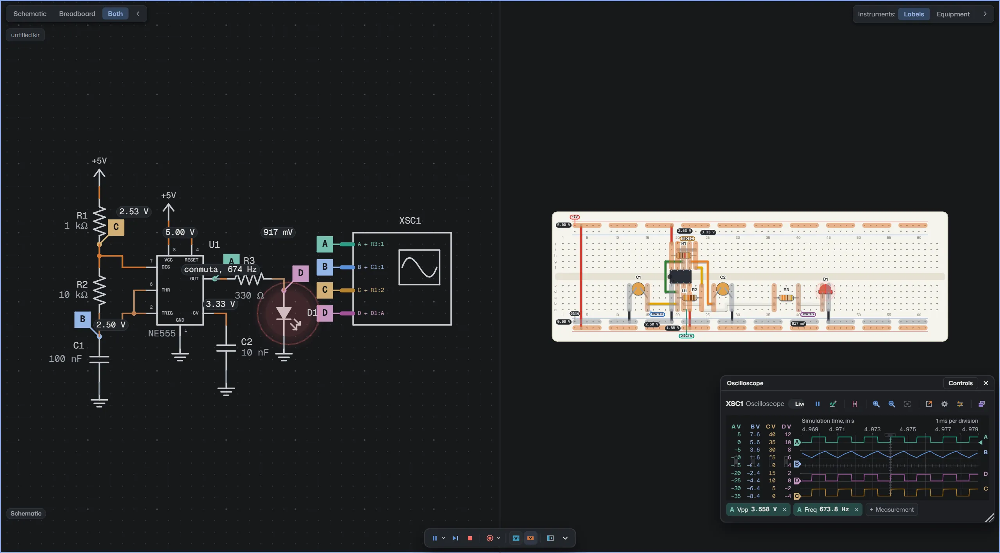

<a href="https://www.youtube.com/watch?v=X_N-icyevDk">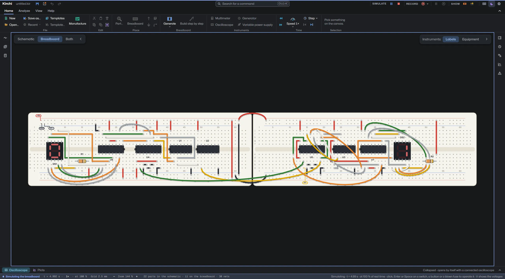</a> 
<a href="https://www.youtube.com/watch?v=X_N-icyevDk">Watch what is new in 3.2 on YouTube</a>

<a href="#simulate-and-see-the-voltage-on-every-wire">Simulate</a> ·
<a href="#build-the-breadboard-step-by-step">Breadboard</a> ·
<a href="#measure-like-in-the-lab">Instruments</a> ·
<a href="#analyze-with-ngspice">Analysis</a> ·
<a href="#open-circuits-from-proteus-kicad-ltspice-and-falstad">Import</a> ·
<a href="#export-for-manufacturing-and-for-your-report">Export</a> ·
<a href="#download-and-install">Download</a> ·
<a href="#what-is-new-in-32">What is new</a> ·
<a href="docs/guia-de-uso.en.md">User guide</a>

Free · No account · Offline, no data sent · English and Spanish · Windows, macOS and Linux

## Simulate and see the voltage on every wire

Press F5 and the circuit runs: wires are colored by voltage and current moves through every branch. The arrow next to Simulate chooses whether the schematic or the breadboard is simulated. There are eight speeds, from ×10 to ×0.001, and knobs, switches and keypads work while it runs.

<table>
  <tr>
    <td width="50%" valign="top">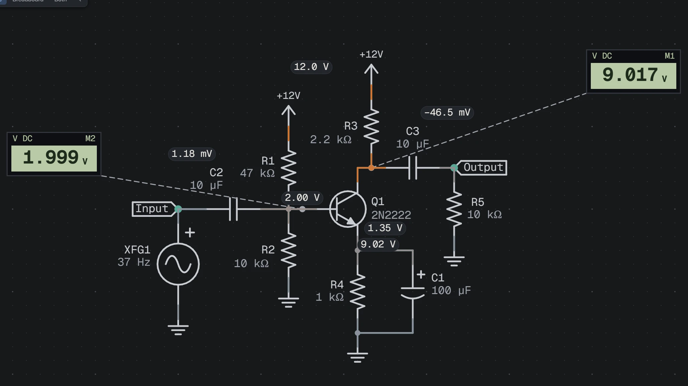 The voltage of every net on the schematic, with two multimeters.</td>
    <td width="50%" valign="top">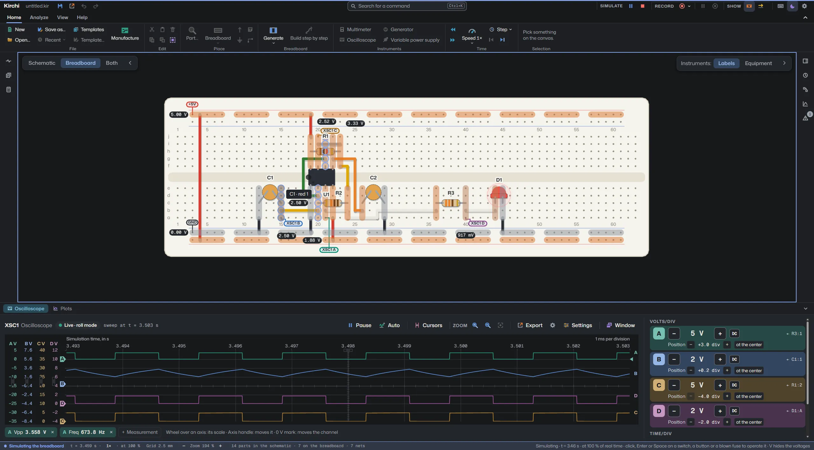 On the breadboard, each net shows a single value and the net under the pointer marks its holes.</td>
  </tr>
</table>

## Build the breadboard step by step

Generate breadboard lays the schematic out on an 830, 400 or 170-point breadboard, with parts that look like the real thing and resistors with their color bands, and Generate schematic goes the other way. Build step by step shows how to build it on your desk: first the chips, then the jumpers to the rails, the resistors and capacitors, the potentiometers and finally the signal wires, one at a time and in the order the signal follows, with the coordinates of their two holes.

With a right click, Change breadboards offers other combinations and marks the suggested one, and Spread over these breadboards builds the circuit on the ones you already placed. Whatever is missing, extra or shorted is marked on the breadboard and listed in Warnings.

<table>
  <tr>
    <td width="50%" valign="top">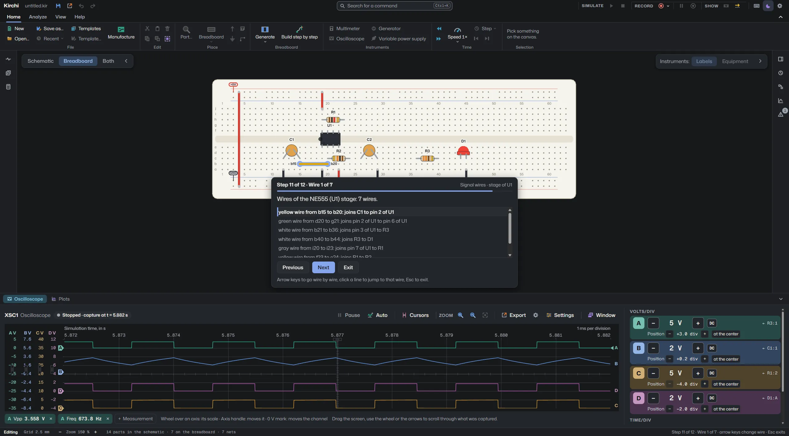 Build step by step, on the signal wires of the 555 stage.</td>
    <td width="50%" valign="top">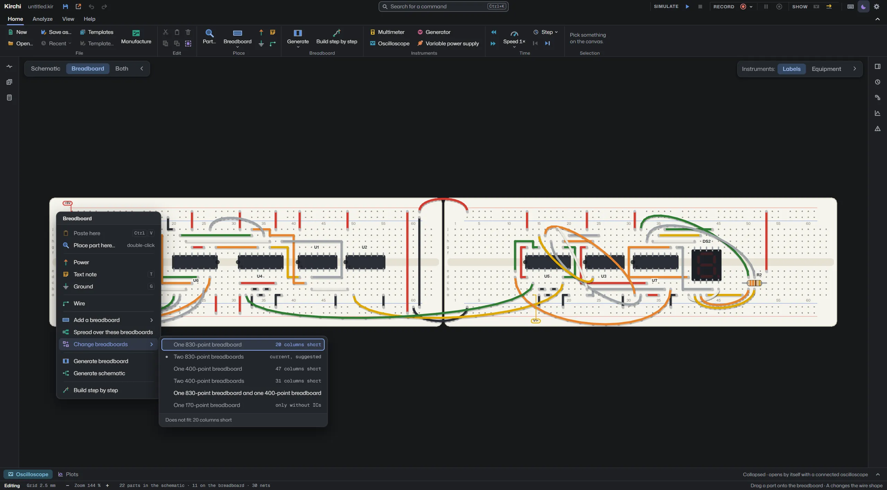 Change breadboards says which one fits best and why the others do not fit.</td>
  </tr>
</table>

## Measure like in the lab

Four-channel oscilloscope with trigger, cursors, automatic measurements and X-Y mode, multimeter, function generator and variable power supply. With right click › Measure you place probes on any wire, and on the clean canvas the oscilloscope sits in a floating panel.

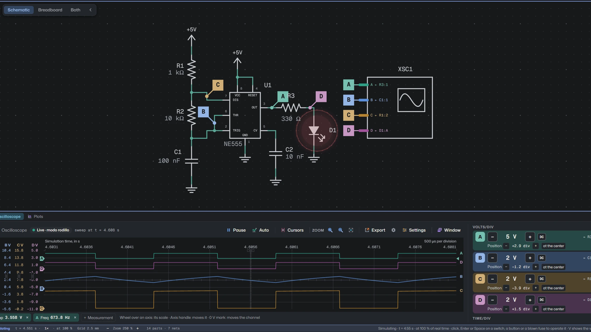 The four signals of a 555 at once, with their probes on the schematic.

## Analyze with ngspice

<table>
  <tr>
    <td width="40%" valign="top">ngspice 47 is included and solves operating point, DC sweep, transient, AC and Bode, Fourier and parameter sweep.  Plots have cursors, traces against each other (X-Y) and ranges you can type.</td>
    <td width="60%" valign="top">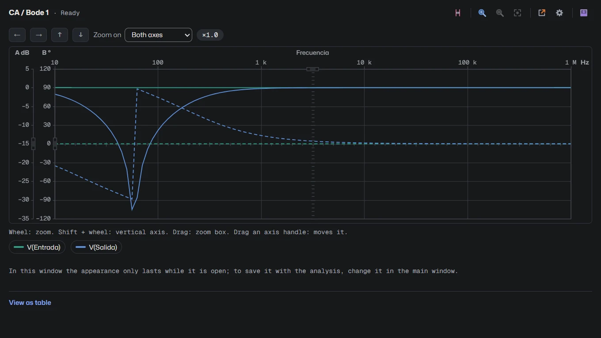 Bode plot of a 60 Hz notch filter.</td>
  </tr>
</table>

## Open circuits from Proteus, KiCad, LTspice and Falstad

Import opens projects from Proteus 8 and 9, LTspice, KiCad 7 to 9, Falstad and SPICE netlists as a new document. A report says what was approximated, and anything with no equivalent comes in as a gray box.

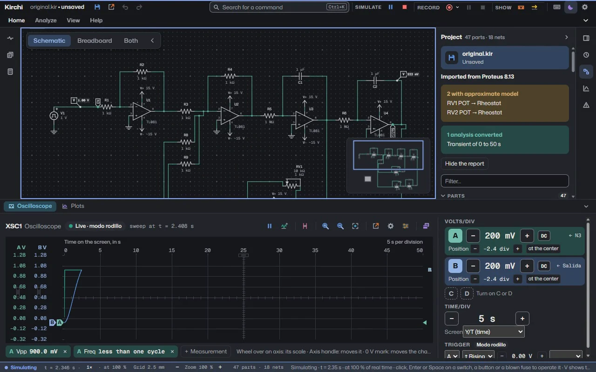 A Proteus project opened in Kirchi, with its import report.

## Export for manufacturing and for your report

File › Export for manufacturing checks the KiCad footprint of every part and writes a KiCad project, the bill of materials for JLCPCB and the netlist. A sixteen-step guide takes you from there to the Gerber files, and the board is drawn in KiCad.

For your report, the schematic, the breadboard and the plots export to PNG, SVG or PDF, and the window records to MP4 video, with an oscilloscope open in its own window included in the video.

<table>
  <tr>
    <td width="50%" valign="top">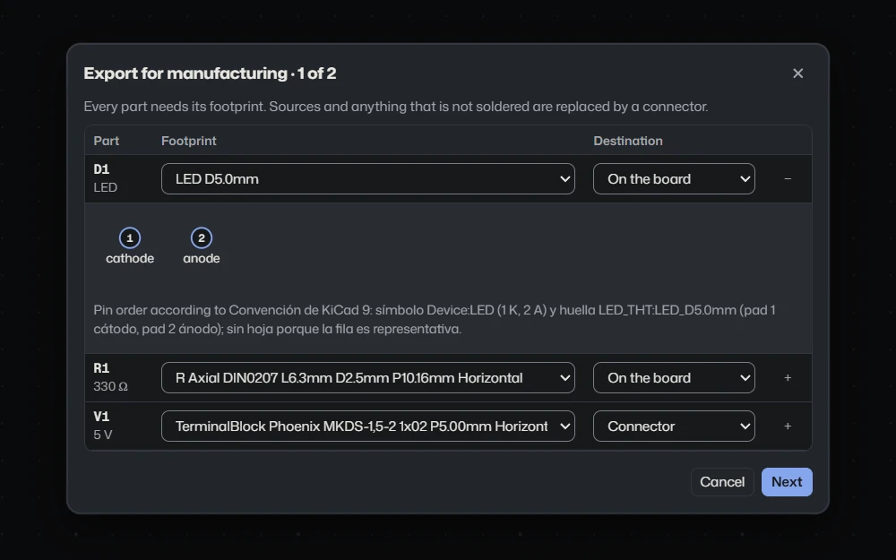 The footprint and destination of every part before exporting to KiCad.</td>
    <td width="50%" valign="top">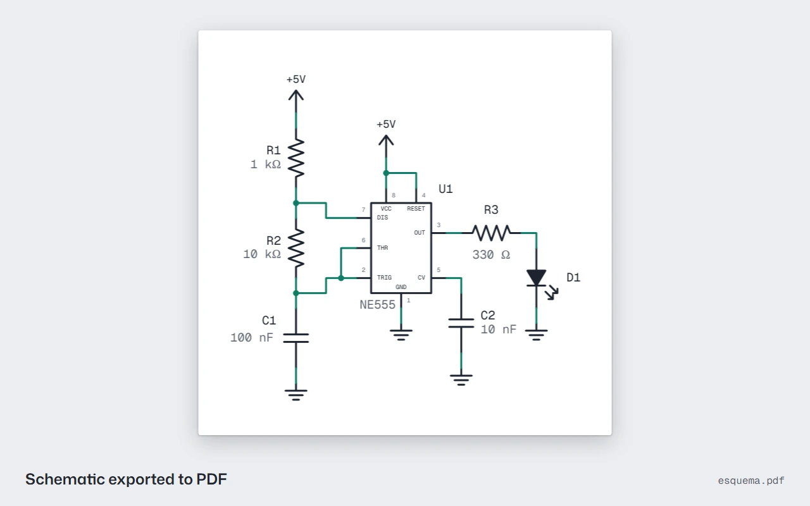 The schematic exported to PDF.</td>
  </tr>
</table>

## Start from a template

<table>
  <tr>
    <td width="60%" valign="top">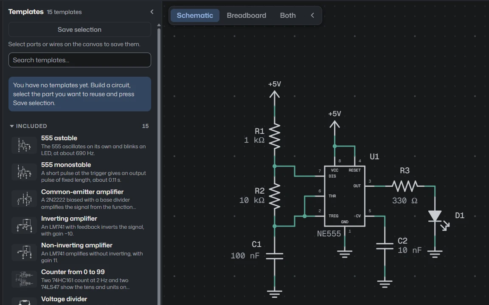</td>
    <td width="40%" valign="top">Fifteen circuits ready to simulate, from the voltage divider to the 555.  Six calculators show the equation with your values, pick commercial values and place the circuit. Whatever you build can be kept as your own template with Save selection.</td>
  </tr>
</table>

## An AI assistant, if you want one

<table>
  <tr>
    <td width="45%" valign="top">An assistant like Claude can build, simulate and measure in Kirchi through the MCP protocol. It comes turned off and everything happens on your computer.
      <ol>
        <li>Open Settings › Assistant and turn on the permission.</li>
        <li>Click “Copy the assistant settings” and paste the text into your MCP client (Claude Desktop, Claude Code or another).</li>
        <li>Ask it for something, for example “build a divider that gives 3.3 V from 5 V and measure the output”.</li>
      </ol>
      Every step can be undone with Ctrl+Z.</td>
    <td width="55%" valign="top">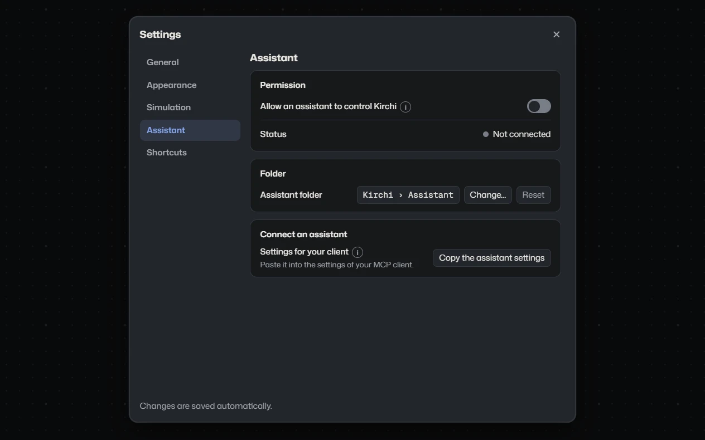</td>
  </tr>
</table>

## English and Spanish, offline

The interface, the parts, the templates, the calculators, the tutorial and the user guide are in English and Spanish. You choose the language in Settings (Automatic follows the system) or with Ctrl+K › Change language, and it changes right away. Kirchi needs no internet and no account, sends no data, and its Windows installer weighs less than 100 MB.

<table>
  <tr>
    <td width="50%" valign="top">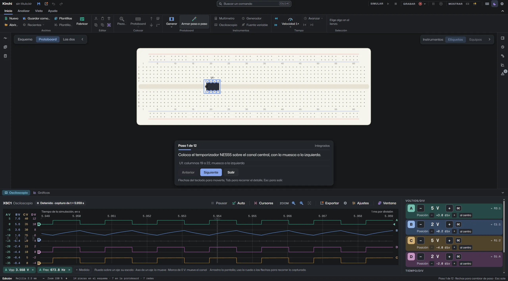 Español</td>
    <td width="50%" valign="top">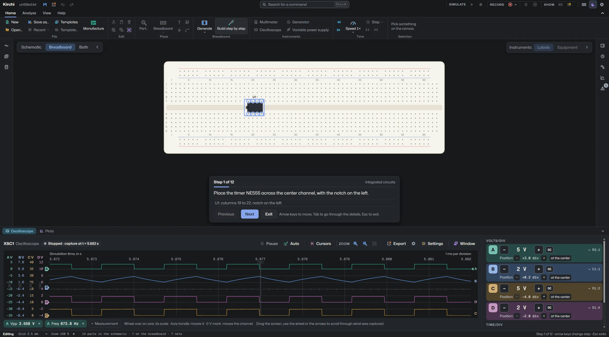 English</td>
  </tr>
</table>

## Download and install

The easiest way on Windows is the [Microsoft Store](https://apps.microsoft.com/detail/9pks3qd294cn), which installs and updates Kirchi by itself. For any system, the files are on the [download page](https://kirchi.app/en/) and on [Releases](../../releases/latest). Those installers are not signed with a paid certificate, so each system asks for a confirmation the first time:

| System | File | The first time |
|---|---|---|
| Windows 10 and 11 | `Kirchi-x.y.z-Windows-instalador.exe` | SmartScreen warns about an unknown publisher: “More info” and “Run anyway”. |
| Windows portable | `Kirchi-x.y.z-Windows-portable.zip` | Unzip it and open `Kirchi.exe`, with nothing to install. |
| macOS | `Kirchi-x.y.z-macOS.dmg` (universal) | Drag Kirchi to Applications and the first time use right click › Open. If macOS cannot verify it, open System Settings › Privacy & Security and click “Open Anyway”. If it says the app is damaged, run `xattr -cr /Applications/Kirchi.app` in Terminal. |
| Linux | `Kirchi-x.y.z-Linux.AppImage` or `Kirchi-x.y.z-Linux.deb` | The AppImage needs execute permission (`chmod +x`). The `.deb` package is for Debian and Ubuntu. |

Circuits are saved in `.kir` files, which open with a double click. The [user guide](docs/guia-de-uso.en.md) explains every feature.

## What is new in 3.2

- **Build step by step** shows how to build the breadboard on your desk, with the signal wires one at a time and in signal order.
- **Change breadboards** offers one or two breadboards of 830, 400 or 170 points and marks the suggested combination, and **Spread over these breadboards** builds the circuit on the ones you already placed.
- **One value per net** on the breadboard, and voltage colors take their scale from the signals: a small voltage now shows its color.
- **Simulate** chooses with its arrow whether the schematic or the breadboard is simulated.
- **Clean canvas** with a collapsible bar and the oscilloscope in a floating panel, which also goes into the recording.
- **Proteus import** brings 19 new parts: in the test projects the gray boxes drop from 417 to 223.
- The whole interface says “breadboard”, and “board” is kept for the printed circuit board.

The full detail is in the [changelog](CHANGELOG.en.md).

## Suggestions

What is your simulator missing? Tell me what gets in your way in Proteus, KiCad, LTspice or the program you use, and what you would like Kirchi to have, at [kirchi.app/en/sugerencias](https://kirchi.app/en/sugerencias).

## Support Kirchi

Kirchi is free and you can use all of it without paying anything. If it is useful to you, you can contribute so it keeps being maintained, on [GitHub Sponsors](https://github.com/sponsors/MisaelAvila49), [PayPal](https://paypal.me/MisaelAvila49) or [Mercado Pago](https://link.mercadopago.com.mx/kirchi). It is optional and unlocks nothing: every feature is the same for everyone.

## License and third-party notices

Kirchi is free to use under its [terms of use](LICENSE): you may use it and share the official installers without charging for them, but not sell it or distribute modified copies. Its source code is not public since version 3.1.1. Versions up to 3.0.0 were published under the MIT license and 3.1.0 under Apache 2.0, and they remain under those licenses.

Analyses are solved by ngspice 47, which Kirchi runs as a separate program, in its own process and without linking it, built from the official source without changes. Each Release publishes `Kirchi-X.Y.Z-fuentes-de-terceros.zip` with the source code of ngspice 47 and of the `faer` crate, along with their SHA-256 sums. KiCad does not ship with Kirchi: Export for manufacturing writes files that open in KiCad, which is installed separately. Electron, Chromium, the typefaces and the other libraries keep their own licenses, which ship with the app, are shown in “About” and are collected in [docs/licencias-terceros.md](docs/licencias-terceros.md). Kirchi sends no data: [privacy notice](https://gist.github.com/MisaelAvila49/26b174fbe0fbfba7ef4c4176b3a25404).

## Contact

Made by Misael Saúl Avila López · [misaelavila49@gmail.com](mailto:misaelavila49@gmail.com)
