

[Español: README.md](README.md)

# Kirchi

**The circuit simulator you wish you had had in college.**

Build the circuit, press F5 and watch it work. Free, offline, no account, in English and Spanish.

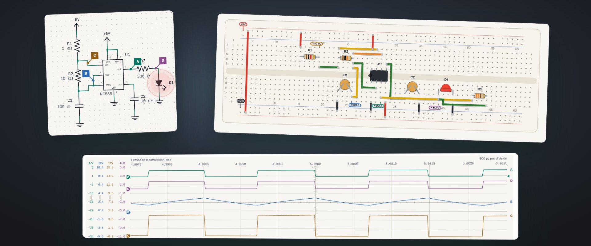

<a href="#whats-new-in-31">What is new</a> · <a href="#breadboard">Breadboard</a> · <a href="#screenshots">Screenshots</a> · <a href="#download-and-install">Download</a> · <a href="#how-it-works">How it works</a> · <a href="docs/guia-de-uso.en.md">User guide</a>

<a href="https://www.youtube.com/watch?v=UEJBj35t4yg">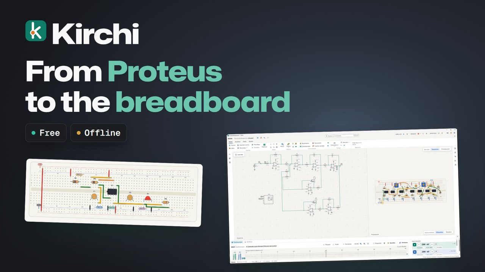</a> <a href="https://www.youtube.com/watch?v=UEJBj35t4yg">Watch the trailer (YouTube)</a>

## Why Kirchi

Kirchi is a desktop circuit simulator for studying electronics: you draw the schematic on a grid, simulate in real time and measure as in the lab, with an oscilloscope, a multimeter and formal analyses with ngspice.

| | |
|---|---|
| **Free** | No expiring trials, no ads and no paid features. |
| **No internet, no account** | Everything happens on your computer. No data is sent. |
| **See it work** | Wires are colored by voltage, current moves through every branch, LEDs light up and parts burn out when they exceed their maximum. |
| **Measure like in the lab** | Four-channel oscilloscope with probes and X-Y mode, multimeter, function generator, variable power supply and quick meters on any wire. |
| **Real analysis** | ngspice is included: operating point, DC sweep, transient, Bode, Fourier and parameter sweep. |
| **Ready for your report** | Export schematics and plots to PNG, SVG or PDF with titles, arrows, numbered callouts and readings. |
| **Easy to learn** | Interface in English and Spanish, an in-app tutorial, templates and calculators that build the circuit. |

## What is new in 3.1

| | |
|---|---|
| **Make a board** | File › Export for manufacturing checks the footprint of every part and writes a KiCad project, the bill of materials for JLCPCB and the netlist. A sixteen-step guide takes you to the Gerber files. |
| **English and Spanish** | The interface, the parts, the templates, the calculators and the tutorial are in both languages. You choose it in Settings or with `Ctrl+K`. |
| **Offline help** | The Help tab groups Learn, Kirchi, Support us and Community. The user guide and the release notes open inside the application, with no internet. |
| **Stable breadboard layout** | Build breadboard gives the same layout every time, with each stage kept together and a straight jumper for every power pin. |

The full detail is in the [changelog](CHANGELOG.en.md).

## Breadboard

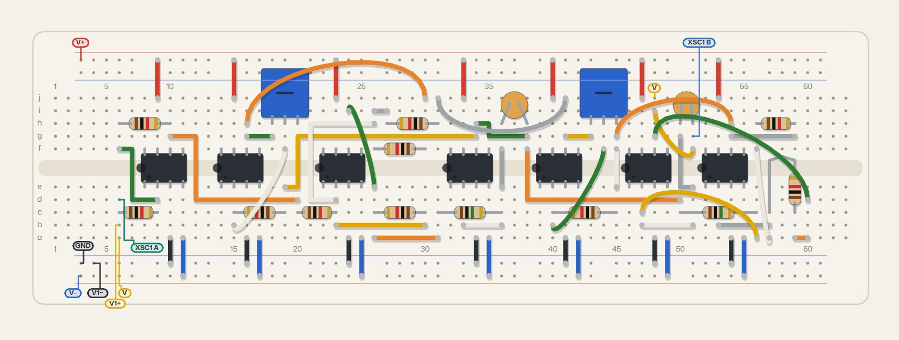 An analog computer with seven TL081, laid out by Build breadboard and exported from Kirchi.

The schematic is the blueprint and the breadboard is what gets built. Build breadboard lays the circuit out on the board, with each stage kept together, a straight jumper for every power pin and the same layout every time. Build schematic goes the other way.

- Boards of 830, 400 and 170 points, with parts that look like the real thing and resistors with their color bands.
- Whatever is missing, extra or shorted is marked on the board and listed in Warnings.
- The open tab is what gets simulated and analyzed, with the strips tinted by their voltage.
- With Measure, in the right-click menu, you plug in the probes of a multimeter or an oscilloscope.
- It exports to PNG, SVG or PDF.

## Screenshots

<table>
  <tr>
    <td width="50%">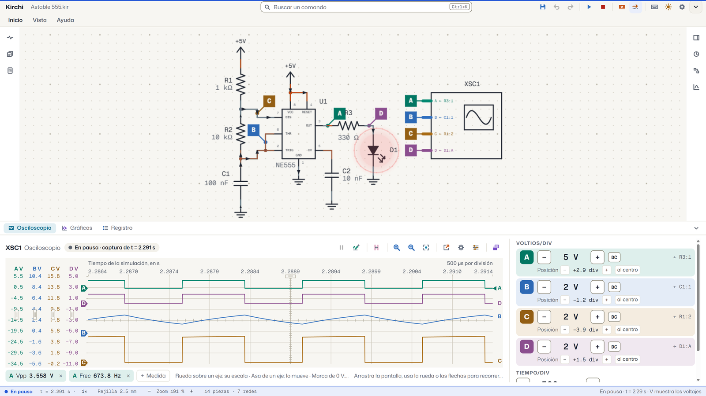 Four signals from a 555 at once, with probes on the circuit.</td>
    <td width="50%">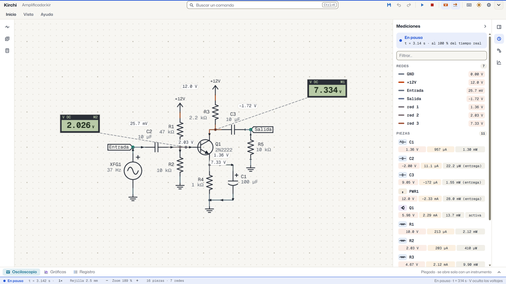 The voltage on every wire, current in motion and quick meters.</td>
  </tr>
  <tr>
    <td>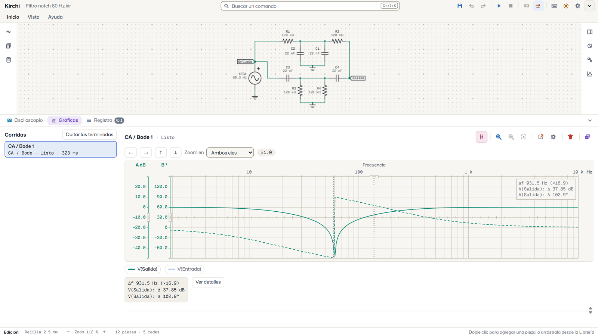 Bode plot of a 60 Hz notch filter, with cursors.</td>
    <td>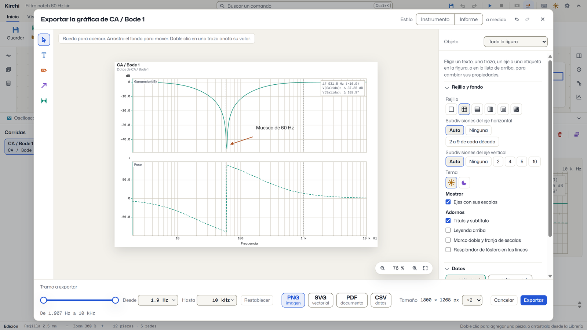 The annotated plot, ready to export.</td>
  </tr>
  <tr>
    <td>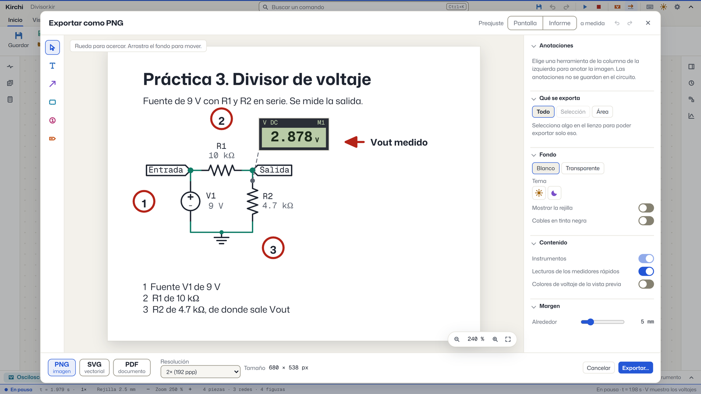 The schematic with title, arrows, numbers and readings.</td>
    <td>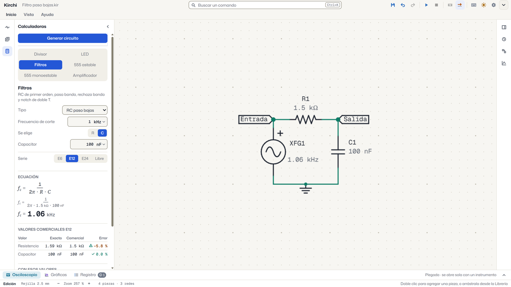 Calculate a filter and build its circuit with one click.</td>
  </tr>
</table>

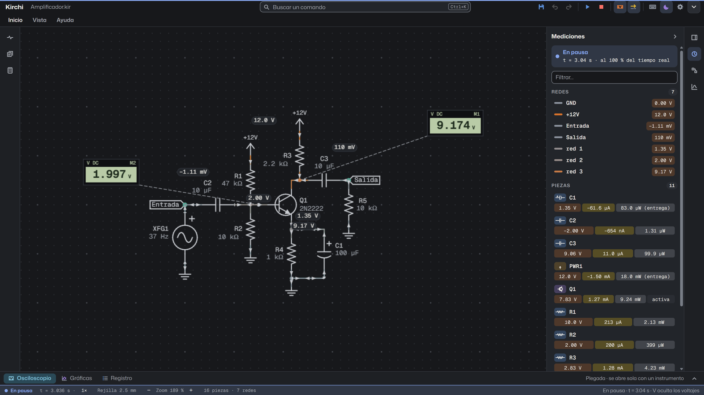 Also in dark theme.

## From circuit to board

The path of a circuit in Kirchi, from drawing or importing it to delivering or manufacturing it:

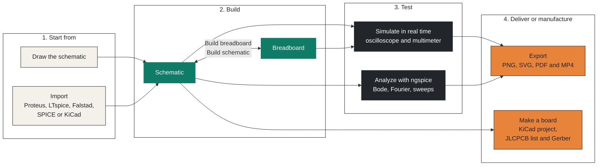

## What is included

**Schematic editor.** A 2.5 mm grid with ANSI/IEEE symbols and 113 parts with an electrical model in nine categories (passives, sources, semiconductors, integrated circuits, digital, switches, indicators, electromechanical and instruments), with sensors, stepper motors, JFETs, IGBTs, optocouplers, controlled sources and MSI logic (decoders, multiplexers, adder, comparator, counters and shift registers, and the ADC0804 converter). Multi-unit chips are named U1A, U1B and show the number of each pin, and wires route themselves without crossing parts. Values with units and standard series (`4k7`, `100n`), a command search with `Ctrl+K`, notes, labels and undo.

**Breadboard.** Besides the schematic, a breadboard view with 830, 400 and 170-point boards and parts that look like the real thing, with color-banded resistors included. The schematic and the breadboard work separately with the same parts: you can place, copy and delete in either one, and Build breadboard and Build schematic sync them in both directions. Whatever is missing or differs is marked and listed in Warnings. The open tab is what gets simulated and analyzed, with the strips tinted by their voltage, and with Measure in the right-click menu of a board part you plug in the probes of a multimeter or an oscilloscope. It exports to PNG, SVG or PDF.

**Real-time simulation.** Our own analog and digital engine, with the same equations as ngspice. Eight speeds, from ×10 to ×0.001, stepping forward and back in time, live knobs (potentiometer, thermistors, photoresistor, sensors) and switches you can operate while it runs, and warnings when a part exceeds its limits.

**Instruments.** Four-channel oscilloscope with trigger, cursors, automatic measurements and X-Y mode. While paused you can change its scales over what was already captured. Multimeter, function generator with peak-to-peak, peak or rms amplitude, variable power supply and quick meters with a seven-segment display.

**Analysis with ngspice 47.** Operating point, DC sweep, transient, AC and Bode, Fourier and parameter sweep. Plots with cursors, traces against each other (X-Y) and ranges you can type.

**For your assignments.** Export to PNG, SVG and PDF with a white background or dark theme, only the selection or an area, and annotations that do not clutter your circuit. Record the window as an MP4 video, with or without a microphone.

**Import.** Open circuits from Falstad, LTspice, SPICE netlists, KiCad and Proteus as a new document, with a report of what was converted and a gray box for anything with no equivalent.

**Make a board.** File › Export for manufacturing checks the footprint of every part and writes a KiCad project (schematic, empty board and symbol library), the bill of materials for JLCPCB and the netlist. A sixteen-step guide inside Kirchi takes you from the circuit, through that export and KiCad, to the Gerber files. You draw the board in KiCad.

**To learn.** The “Learn Kirchi” tutorial with five chapters, fifteen templates ready to simulate and six calculators (divider, LED, filters, 555 astable and monostable, amplifier) that show the equation with your values and build the circuit.

**English and Spanish.** The interface, the parts, the tutorial and the templates are available in both languages. You choose the language in Settings or with `Ctrl+K`.

**Assistant (optional).** An AI assistant such as Claude can build, simulate and measure circuits in Kirchi over the MCP protocol. It comes turned off and everything happens on your machine.

The full guide is at [docs/guia-de-uso.en.md](docs/guia-de-uso.en.md) ([Español](docs/guia-de-uso.md)).

## Connect an assistant (optional)

Kirchi works offline and the assistant comes turned off. To use it:

1. Open Settings › Assistant and turn on the permission.
2. Click “Copy the assistant settings” and paste the text into the settings of your MCP client (Claude Desktop, Claude Code or another). The tab status reads “Ready. Write to the assistant from your client.”
3. Ask it for something, for example “build a divider that gives 3.3 V from 5 V and measure the output”.

The assistant can build, simulate, read measurements and export the image of the open circuit, use templates and calculators, save analyses and plot by pin, and work with the files in Documents\Kirchi\Asistente. Every step can be undone with Ctrl+Z. With the installer the settings use the full path to Kirchi, and with the Microsoft Store they use the `kirchi` alias.

## Download and install

The easiest way on Windows is the [Microsoft Store](https://apps.microsoft.com/detail/9pks3qd294cn). For any system, the installers are on [Releases](../../releases/latest) and on the [download page](https://misaelavila49.github.io/Kirchi/en/).

The Microsoft Store installs and updates Kirchi by itself. With the files from Releases, the installers are not signed with a paid certificate, so each system asks for a confirmation the first time:

| System | File | The first time |
|---|---|---|
| Windows | `Kirchi-x.y.z-Windows-instalador.exe` | SmartScreen warns about an unknown publisher: “More info” and “Run anyway”. |
| Windows portable | `Kirchi-x.y.z-Windows-portable.zip` | Unzip it and open `Kirchi.exe`, with nothing to install. |
| macOS | `Kirchi-x.y.z-macOS.dmg` | Drag Kirchi to Applications. If macOS cannot verify it, open System Settings › Privacy & Security and click “Open Anyway”. If it says the app is damaged, run `xattr -cr /Applications/Kirchi.app` in Terminal. |
| Linux | `Kirchi-x.y.z-Linux.AppImage` or `Kirchi-x.y.z-Linux.deb` | The AppImage needs execute permission (`chmod +x`). |

Circuits are saved in `.kir` files, which open with a double click.

## How it works

Kirchi is an Electron application with the interface in SolidJS and its own WebGL2 canvas. The real-time simulation runs in an engine written in Rust, compiled to WebAssembly, inside a Web Worker that shares memory with the interface. Formal analyses are solved by ngspice as a separate process.

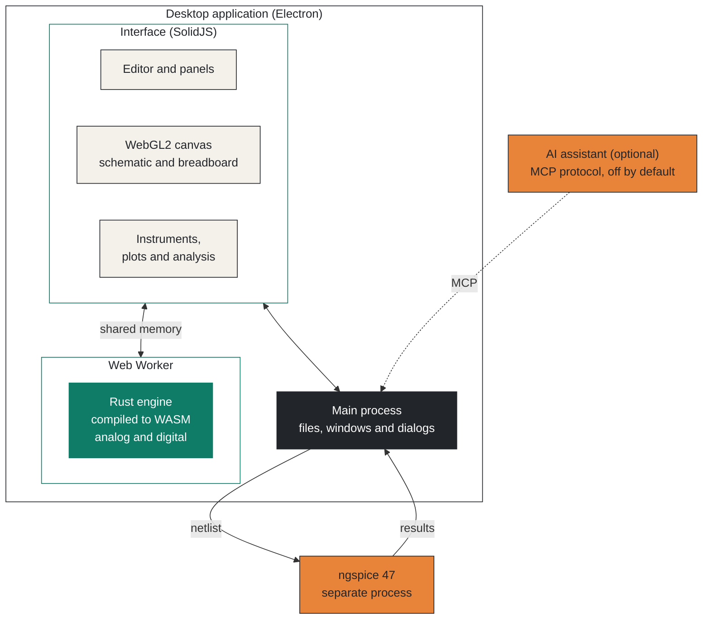

## Support Kirchi

Kirchi is free. If it is useful to you, you can support its development with a voluntary contribution, on [GitHub Sponsors](https://github.com/sponsors/MisaelAvila49), [PayPal](https://paypal.me/MisaelAvila49) or [Mercado Pago](https://link.mercadopago.com.mx/kirchi). It does not unlock anything: every feature is the same for everyone.

## License

Kirchi is free of charge and is used under its [terms of use](LICENSE): you may use it and share the official installers without charging for them, but not sell it or distribute modified copies. Kirchi's source code is not public since version 3.1.1; versions up to 3.0.0 were published under the MIT license and 3.1.0 under Apache 2.0, and they remain under those licenses. ngspice, the typefaces and the other dependencies keep their own licenses, which are collected in [docs/licencias-terceros.md](docs/licencias-terceros.md) and shown in “About”; the source code their licenses require is provided with each release. Kirchi sends no data: [privacy notice](https://gist.github.com/MisaelAvila49/26b174fbe0fbfba7ef4c4176b3a25404).

Made by Misael Saúl Avila López · [misaelavila49@gmail.com](mailto:misaelavila49@gmail.com)
