

# Kirchi

**Simulador de circuitos gratuito y sin conexión**

Mira el voltaje de cada cable y la señal en un osciloscopio de cuatro canales mientras corre. 
Abre tus circuitos de Proteus, LTspice, KiCad o Falstad. En español o en inglés, sin internet y sin cuenta.

[English: README.en.md](README.en.md)

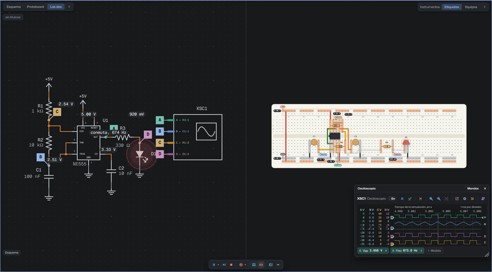

<a href="https://www.youtube.com/watch?v=jf7WSukPmgM">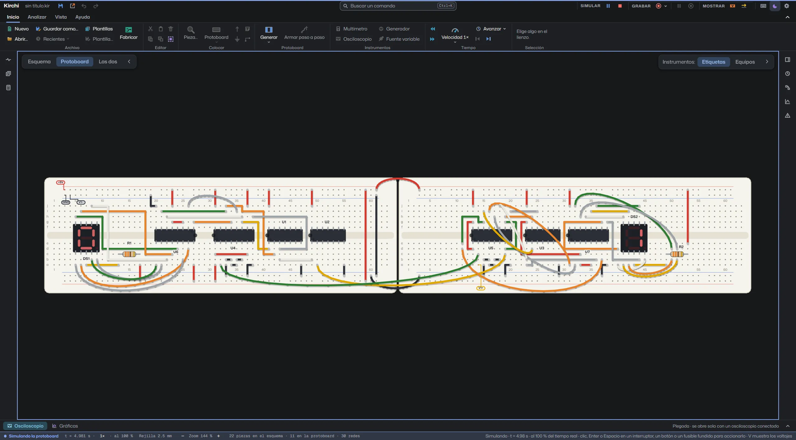</a> 
<a href="https://www.youtube.com/watch?v=jf7WSukPmgM">Mira en YouTube lo nuevo de la 3.2</a>

<a href="#simula-y-mira-el-voltaje-de-cada-cable">Simular</a> ·
<a href="#arma-la-protoboard-paso-a-paso">Protoboard</a> ·
<a href="#mide-como-en-el-laboratorio">Instrumentos</a> ·
<a href="#analiza-con-ngspice">Análisis</a> ·
<a href="#abre-circuitos-de-proteus-kicad-ltspice-y-falstad">Importar</a> ·
<a href="#exporta-para-fabricar-y-para-el-reporte">Exportar</a> ·
<a href="#descargar-e-instalar">Descargar</a> ·
<a href="#qué-hay-de-nuevo-en-la-32">Novedades</a> ·
<a href="docs/guia-de-uso.md">Guía de uso</a>

Gratis · Sin cuenta · Sin internet y sin enviar datos · Español e inglés · Windows, macOS y Linux

## Simula y mira el voltaje de cada cable

Pulsa F5 y el circuito corre: los cables se pintan según su voltaje y la corriente se mueve por cada rama. La flecha junto a Simular elige si se simula el esquema o la protoboard. Hay ocho velocidades, de ×10 a ×0.001, y las perillas, los interruptores y los teclados se accionan mientras corre.

<table>
  <tr>
    <td width="50%" valign="top">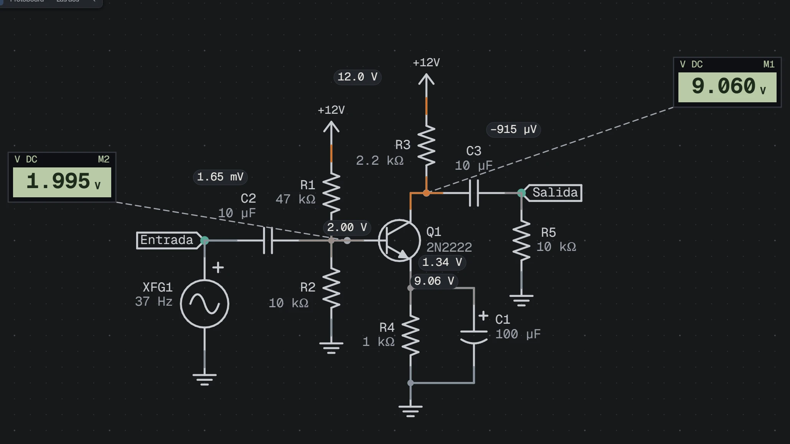 El voltaje de cada red en el esquema, con dos multímetros.</td>
    <td width="50%" valign="top">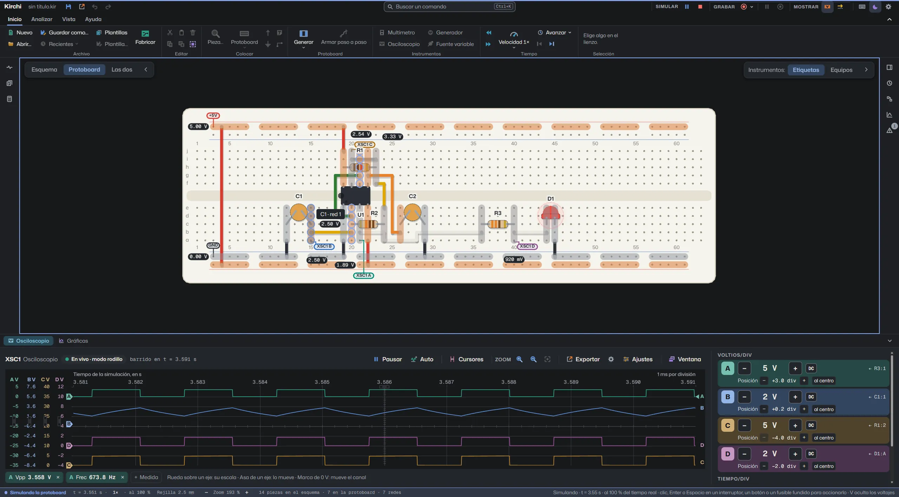 En la protoboard, cada red lleva un solo valor y la red bajo el ratón marca sus agujeros.</td>
  </tr>
</table>

## Arma la protoboard paso a paso

Generar protoboard arma el esquema en una protoboard de 830, 400 o 170 puntos, con piezas de aspecto real y resistencias con sus bandas de color, y Generar esquema hace el camino contrario. Armar paso a paso enseña a armarla en la mesa: primero los integrados, luego los puentes a los rieles, las resistencias y capacitores, los potenciómetros y al final los cables de señal, uno por uno y en el orden que sigue la señal, con la coordenada de sus dos agujeros.

Con el clic derecho, Cambiar protoboards ofrece otras combinaciones y marca la sugerida, y Repartir en estas protoboards arma el circuito en las que ya pusiste. Lo que falta, sobra o hace corto se marca en la protoboard y se lista en Avisos.

<table>
  <tr>
    <td width="50%" valign="top">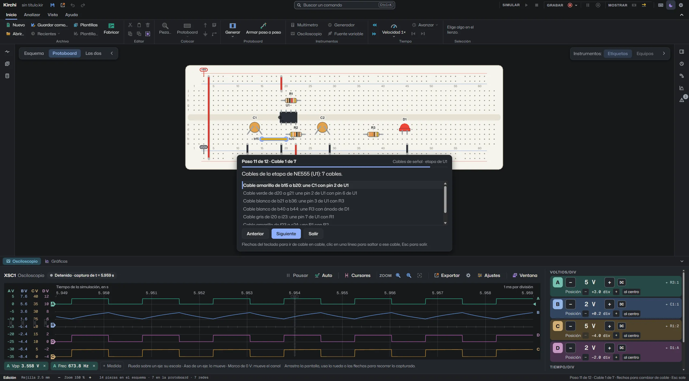 Armar paso a paso, en los cables de señal de la etapa del 555.</td>
    <td width="50%" valign="top">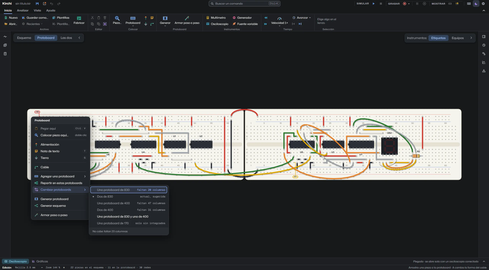 Cambiar protoboards dice cuál conviene y por qué no caben las demás.</td>
  </tr>
</table>

## Mide como en el laboratorio

Osciloscopio de cuatro canales con disparo, cursores, medidas automáticas y modo X-Y, multímetro, generador de funciones y fuente variable. Con clic derecho › Medir pones las puntas sobre cualquier cable, y en el lienzo limpio el osciloscopio va en un panel flotante.

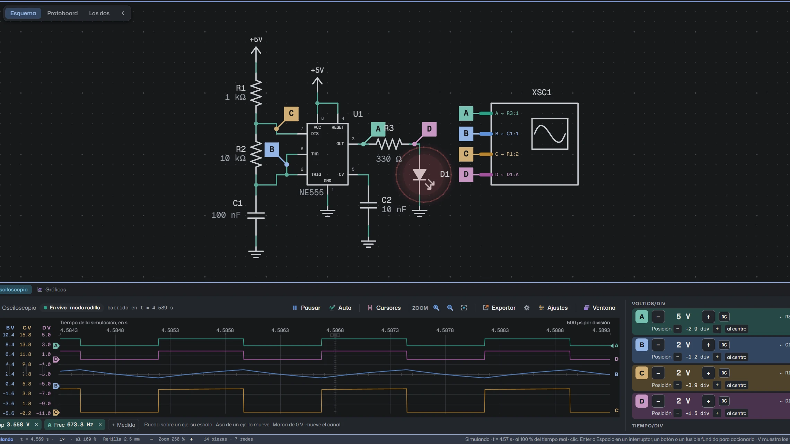 Las cuatro señales de un 555 a la vez, con sus sondas sobre el esquema.

## Analiza con ngspice

<table>
  <tr>
    <td width="40%" valign="top">ngspice 47 viene incluido y resuelve punto de operación, barrido de CD, transitorio, CA y Bode, Fourier y barrido de parámetro.  Las gráficas tienen cursores, trazas una contra otra (X-Y) y rangos que se escriben.</td>
    <td width="60%" valign="top">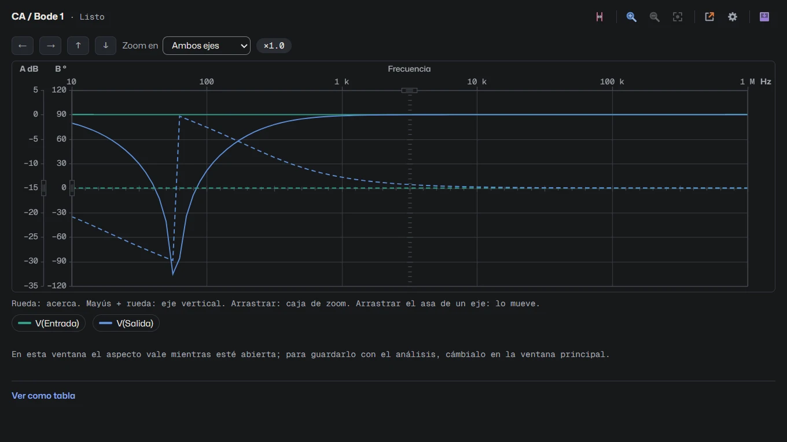 Bode de un filtro notch de 60 Hz.</td>
  </tr>
</table>

## Abre circuitos de Proteus, KiCad, LTspice y Falstad

Importar abre proyectos de Proteus 8 y 9, LTspice, KiCad 7 a 9, Falstad y netlists SPICE como documento nuevo. Un informe dice qué se aproximó, y lo que no tiene equivalencia entra como caja gris.

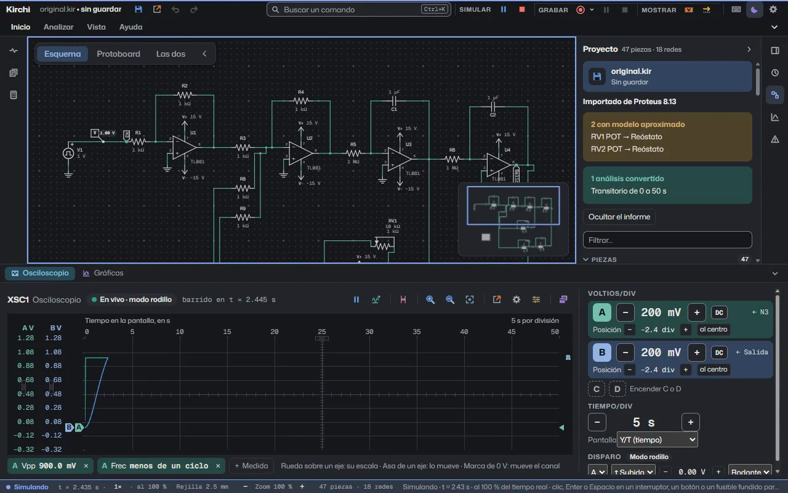 Un proyecto de Proteus abierto en Kirchi, con su informe de importación.

## Exporta para fabricar y para el reporte

Archivo › Exportar para fabricar revisa la huella de KiCad de cada pieza y escribe un proyecto de KiCad, la lista de materiales para JLCPCB y la netlist. Una guía de dieciséis pasos lleva de ahí a los archivos Gerber, y la placa se dibuja en KiCad.

Para el reporte, el esquema, la protoboard y las gráficas salen en PNG, SVG o PDF, y la ventana se graba en video MP4, con el osciloscopio que esté en su propia ventana dentro del video.

<table>
  <tr>
    <td width="50%" valign="top">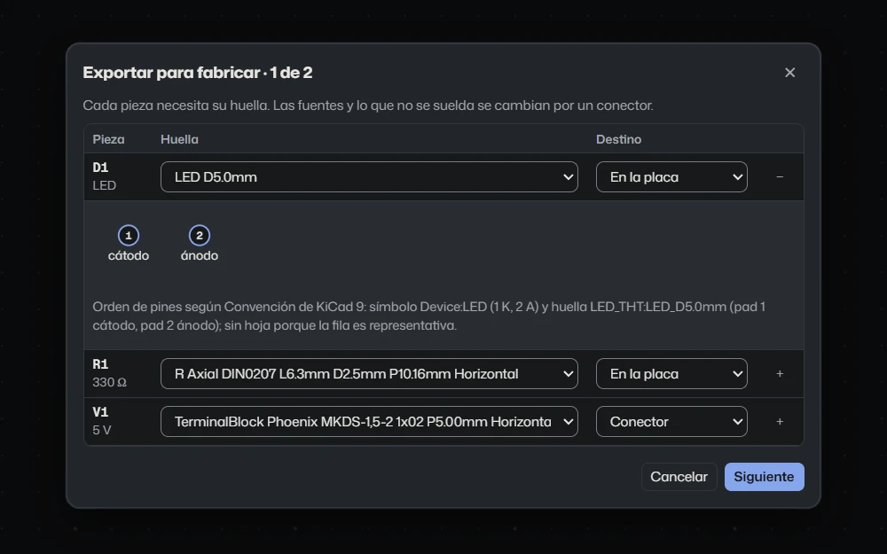 La huella y el destino de cada pieza antes de exportar a KiCad.</td>
    <td width="50%" valign="top">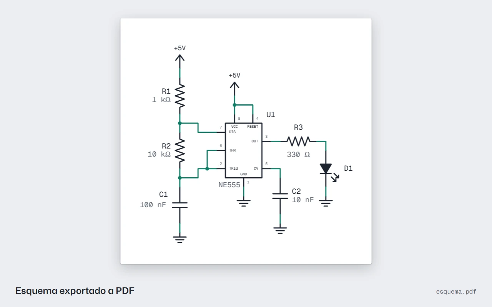 El esquema exportado a PDF.</td>
  </tr>
</table>

## Empieza desde una plantilla

<table>
  <tr>
    <td width="60%" valign="top">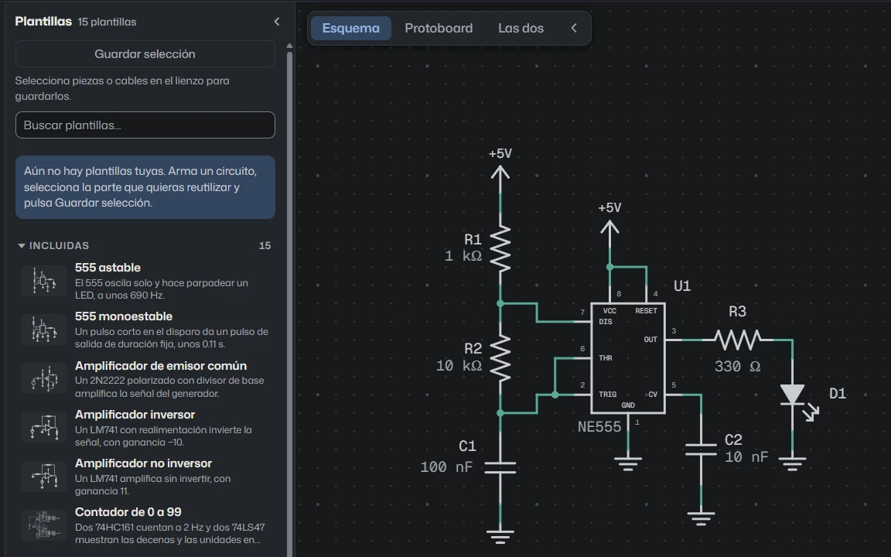</td>
    <td width="40%" valign="top">Quince circuitos listos para simular, del divisor de voltaje al 555.  Seis calculadoras muestran la ecuación con tus valores, eligen valores comerciales y colocan el circuito. Lo que armes se guarda como plantilla tuya con Guardar selección.</td>
  </tr>
</table>

## Un asistente de IA, si quieres

<table>
  <tr>
    <td width="45%" valign="top">Un asistente como Claude puede armar, simular y medir en Kirchi por el protocolo MCP. Viene apagado y todo ocurre en tu computadora.
      <ol>
        <li>Abre Configuración › Asistente y activa el permiso.</li>
        <li>Pulsa «Copiar configuración del asistente» y pega el texto en tu cliente MCP (Claude Desktop, Claude Code u otro).</li>
        <li>Pídele algo, por ejemplo «arma un divisor que dé 3.3 V desde 5 V y mide la salida».</li>
      </ol>
      Cada paso se deshace con Ctrl+Z.</td>
    <td width="55%" valign="top">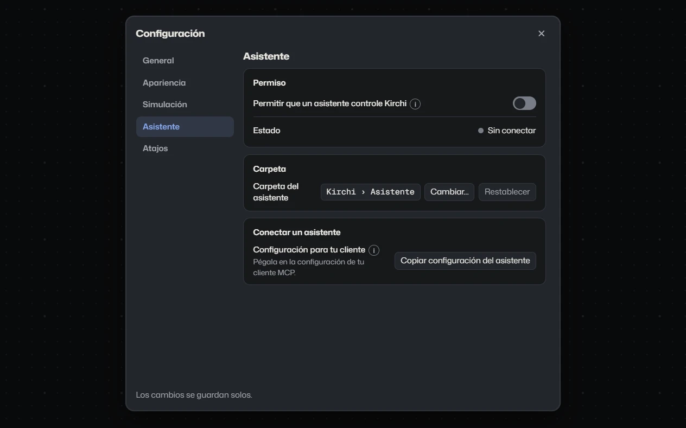</td>
  </tr>
</table>

## En español e inglés, sin conexión

La interfaz, las piezas, las plantillas, las calculadoras, el tutorial y la guía de uso están en español y en inglés. El idioma se elige en Configuración (Automático sigue el del sistema) o con Ctrl+K › Cambiar idioma, y cambia al momento. Kirchi no necesita internet ni cuenta, no envía datos y su instalador de Windows pesa menos de 100 MB.

<table>
  <tr>
    <td width="50%" valign="top">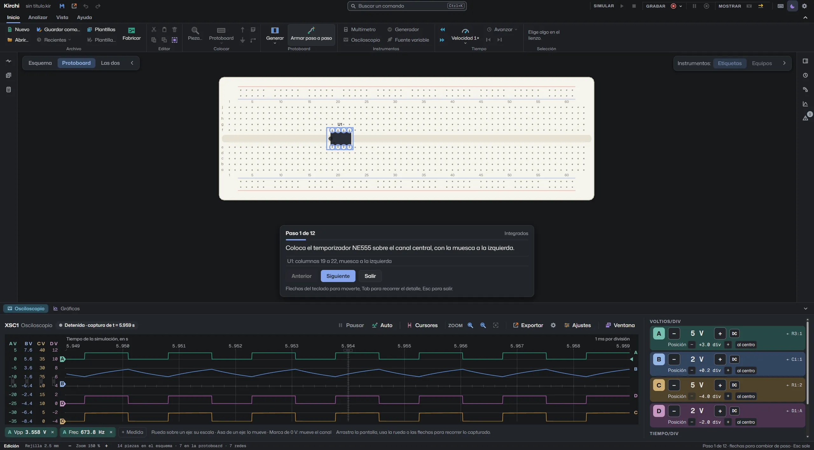 Español</td>
    <td width="50%" valign="top">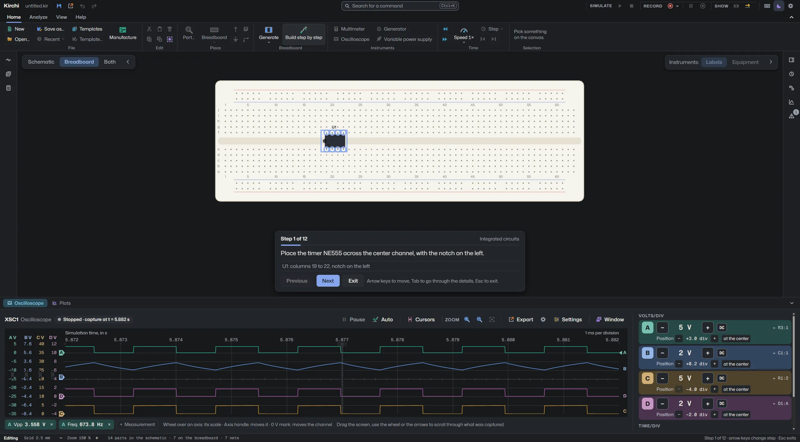 English</td>
  </tr>
</table>

## Descargar e instalar

La forma más sencilla en Windows es la [Microsoft Store](https://apps.microsoft.com/detail/9pks3qd294cn), que instala y actualiza Kirchi sola. Para cualquier sistema, los archivos están en la [página de descarga](https://kirchi.app/) y en [Releases](../../releases/latest). Esos instaladores no están firmados con un certificado de pago, así que cada sistema pide una confirmación la primera vez:

| Sistema | Archivo | La primera vez |
|---|---|---|
| Windows 10 y 11 | `Kirchi-x.y.z-Windows-instalador.exe` | SmartScreen avisa de un editor desconocido: «Más información» y «Ejecutar de todos modos». |
| Windows portátil | `Kirchi-x.y.z-Windows-portable.zip` | Se descomprime y se abre `Kirchi.exe`, sin instalar nada. |
| macOS | `Kirchi-x.y.z-macOS.dmg` (universal) | Arrastra Kirchi a Aplicaciones y la primera vez usa clic derecho › Abrir. Si macOS no puede verificarla, abre Ajustes del Sistema › Privacidad y seguridad y pulsa «Abrir de todos modos». Si dice que está dañada, ejecuta `xattr -cr /Applications/Kirchi.app` en la Terminal. |
| Linux | `Kirchi-x.y.z-Linux.AppImage` o `Kirchi-x.y.z-Linux.deb` | La AppImage necesita permiso de ejecución (`chmod +x`). El paquete `.deb` es para Debian y Ubuntu. |

Los circuitos se guardan en archivos `.kir`, que se abren con doble clic. La [guía de uso](docs/guia-de-uso.md) explica cada función.

## Qué hay de nuevo en la 3.2

- **Armar paso a paso** muestra cómo armar la protoboard en la mesa, con los cables de señal de uno en uno y en el orden de la señal.
- **Cambiar protoboards** ofrece una o dos protoboards de 830, 400 o 170 y marca la combinación sugerida, y **Repartir en estas protoboards** arma el circuito en las que ya pusiste.
- **Un solo valor por red** en la protoboard, y los colores de voltaje toman la escala de las señales: un voltaje chico ya se ve de color.
- **Simular** elige con su flecha si se simula el esquema o la protoboard.
- **Lienzo limpio** con una barra plegable y el osciloscopio en un panel flotante, que también entra a la grabación.
- **Importar Proteus** trae 19 piezas nuevas: en los proyectos de prueba las cajas grises bajan de 417 a 223.
- Toda la interfaz dice «protoboard», y «placa» queda para la placa de circuito impreso.

El detalle completo está en el [historial de cambios](CHANGELOG.md).

## Sugerencias

¿Qué le falta a tu simulador? Cuéntame qué te estorba de Proteus, KiCad, LTspice o el programa que uses, y qué te gustaría que tuviera Kirchi, en [kirchi.app/sugerencias](https://kirchi.app/sugerencias).

## Apoyar a Kirchi

Kirchi es gratis y puedes usarlo completo sin pagar nada. Si te sirve, puedes aportar para que siga manteniéndose, en [GitHub Sponsors](https://github.com/sponsors/MisaelAvila49), [PayPal](https://paypal.me/MisaelAvila49) o [Mercado Pago](https://link.mercadopago.com.mx/kirchi). Es opcional y no desbloquea nada: todas las funciones son iguales para todas las personas.

## Licencia y avisos de terceros

Kirchi es gratis y se usa con sus [términos de uso](LICENSE): puedes usarlo y compartir los instaladores oficiales sin cobrar, pero no venderlo ni distribuir copias modificadas. Su código no es público desde la versión 3.1.1. Las versiones hasta la 3.0.0 se publicaron con la licencia MIT y la 3.1.0 con Apache 2.0, y siguen bajo esas licencias.

Los análisis los resuelve ngspice 47, que Kirchi ejecuta como un programa aparte, en su propio proceso y sin enlazarlo, compilado del código oficial sin cambios. Cada Release publica `Kirchi-X.Y.Z-fuentes-de-terceros.zip` con el código fuente de ngspice 47 y del crate `faer`, junto con sus sumas SHA-256. KiCad no viene con Kirchi: Exportar para fabricar escribe archivos que se abren en KiCad, que se instala aparte. Electron, Chromium, las tipografías y las demás bibliotecas conservan sus licencias, que viajan con la aplicación, se muestran en «Acerca de» y se reúnen en [docs/licencias-terceros.md](docs/licencias-terceros.md). Kirchi no envía datos: [aviso de privacidad](https://gist.github.com/MisaelAvila49/26b174fbe0fbfba7ef4c4176b3a25404).

## Contacto

Hecho por Misael Saúl Avila López · [misaelavila49@gmail.com](mailto:misaelavila49@gmail.com)
