

[English: README.en.md](README.en.md)

# Kirchi

**El simulador de circuitos que te hubiera gustado tener en la carrera.**

Armas el circuito, pulsas F5 y lo ves funcionar. Gratis, sin internet, sin cuenta y en español e inglés.

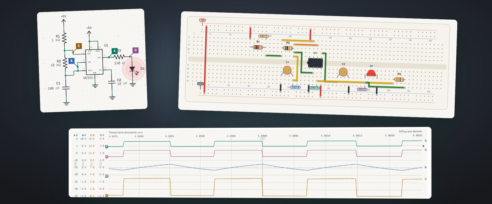

<a href="#novedades-de-la-31">Novedades</a> · <a href="#protoboard">Protoboard</a> · <a href="#capturas">Capturas</a> · <a href="#descargar-e-instalar">Descargar</a> · <a href="#cómo-funciona">Cómo funciona</a> · <a href="docs/guia-de-uso.md">Guía de uso</a>

## Por qué Kirchi

Kirchi es un simulador de circuitos de escritorio para estudiar electrónica: dibujas el esquema en una rejilla, simulas en tiempo real y mides como en el laboratorio, con un osciloscopio, un multímetro y análisis formales con ngspice.

| | |
|---|---|
| **Gratis** | Sin pruebas que caducan, sin anuncios y sin funciones de pago. |
| **Sin internet ni cuenta** | Todo pasa en tu computadora. No se envía ningún dato. |
| **Lo ves funcionar** | Los cables se pintan según su voltaje, la corriente se mueve por cada rama, los LED encienden y las piezas se queman cuando pasan su máximo. |
| **Mide como en el laboratorio** | Osciloscopio de cuatro canales con sondas y modo X-Y, multímetro, generador de funciones, fuente variable y medidores rápidos sobre cualquier cable. |
| **Análisis de verdad** | ngspice viene incluido: punto de operación, barrido de CD, transitorio, Bode, Fourier y barrido de parámetro. |
| **Listo para el reporte** | Exporta esquemas y gráficas a PNG, SVG o PDF con títulos, flechas, llamadas numeradas y lecturas. |
| **Fácil de aprender** | Interfaz en español e inglés (se elige en Configuración), tutorial dentro de la aplicación, plantillas y calculadoras que generan el circuito. |

## Novedades de la 3.1

| | |
|---|---|
| **Fabricar una placa** | Archivo › Exportar para fabricar revisa la huella de cada pieza y escribe un proyecto de KiCad, la lista de materiales para JLCPCB y la netlist. Una guía de dieciséis pasos lleva hasta los archivos Gerber. |
| **Español e inglés** | La interfaz, las piezas, las plantillas, las calculadoras y el tutorial están en los dos idiomas. Se elige en Configuración o con `Ctrl+K`. |
| **Ayuda sin conexión** | La pestaña Ayuda reúne Aprender, Kirchi, Ayúdanos y Comunidad. La guía de uso y las novedades se abren dentro de la aplicación, sin internet. |
| **Armado estable de la protoboard** | Generar protoboard da el mismo armado cada vez, con cada etapa junta y un puente recto para cada pin de alimentación. |

El detalle completo está en el [historial de cambios](CHANGELOG.md).

## Protoboard

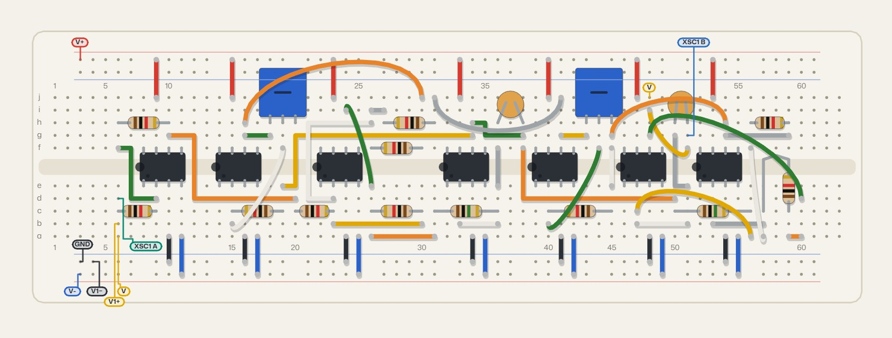 Una computadora analógica con siete TL081, armada por Generar protoboard y exportada desde Kirchi.

El esquema es el plano y la protoboard es lo armado. Generar protoboard arma el circuito en la placa, con cada etapa junta, un puente recto para cada pin de alimentación y el mismo armado cada vez. Generar esquema hace el camino contrario.

- Placas de 830, 400 y 170 puntos, con piezas de aspecto real y resistencias con sus bandas de color.
- Lo que falta, sobra o hace corto se marca en la placa y se lista en Avisos.
- Se simula y se analiza la pestaña abierta, con las tiras teñidas por su voltaje.
- Con Medir, en el clic derecho, se clavan las puntas de un multímetro o un osciloscopio.
- Se exporta a PNG, SVG o PDF.

## Capturas

<table>
  <tr>
    <td width="50%">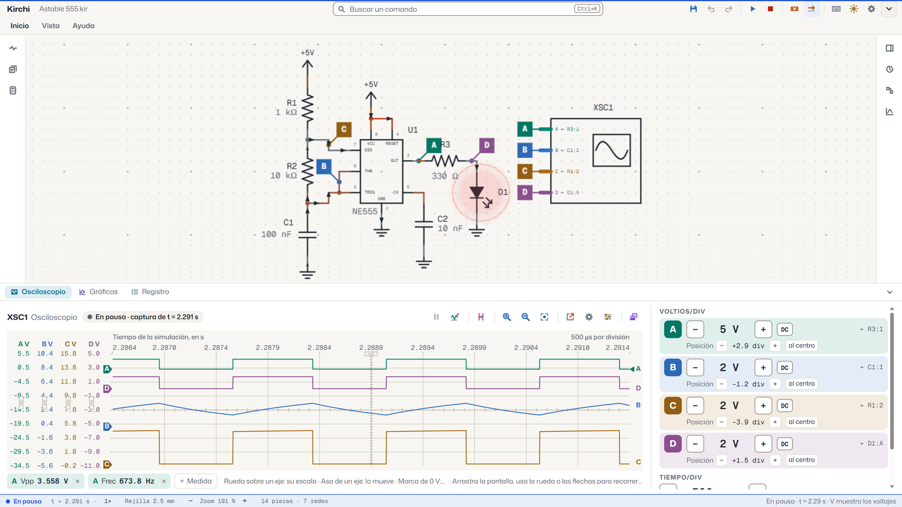 Cuatro señales de un 555 a la vez, con sondas sobre el circuito.</td>
    <td width="50%">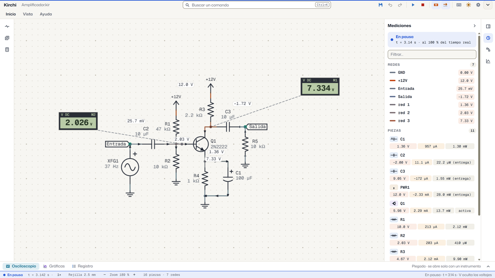 El voltaje de cada cable, la corriente en movimiento y medidores rápidos.</td>
  </tr>
  <tr>
    <td>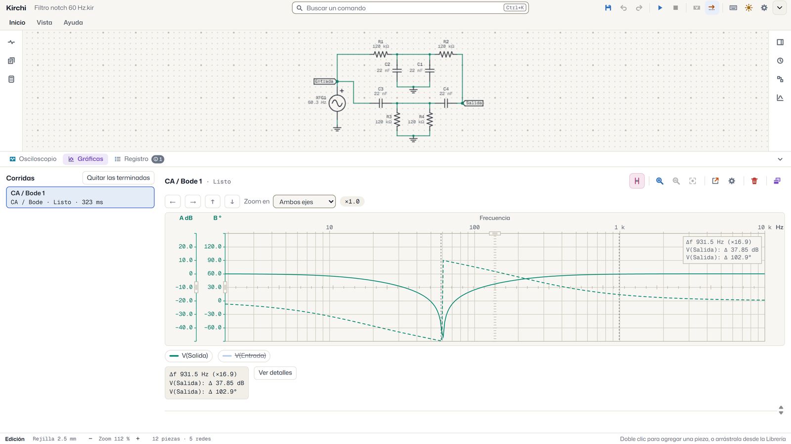 Bode de un filtro notch de 60 Hz, con cursores.</td>
    <td>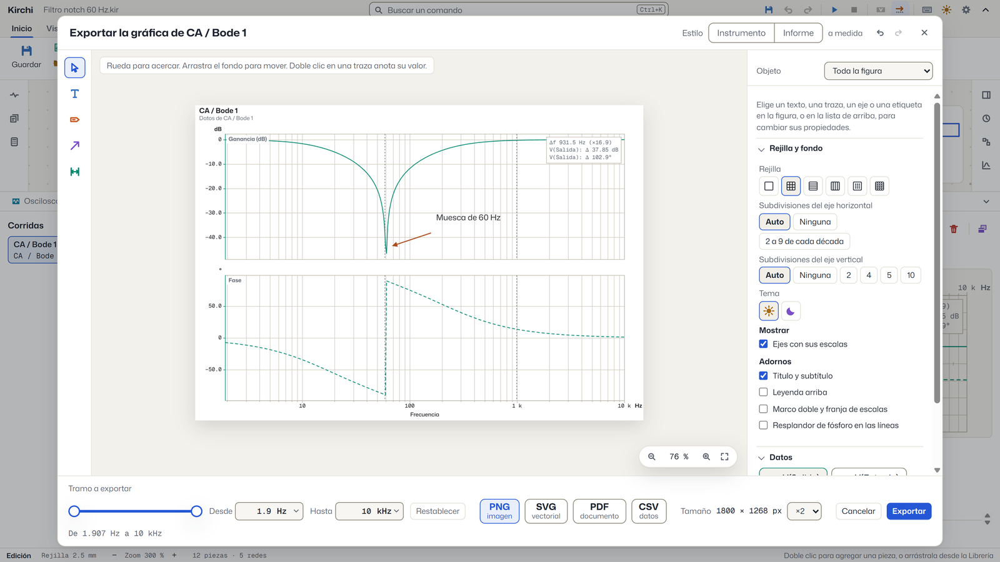 La gráfica anotada y lista para exportar.</td>
  </tr>
  <tr>
    <td>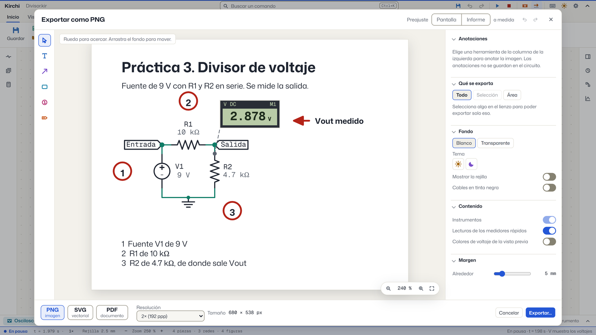 El esquema con título, flechas, números y lecturas.</td>
    <td>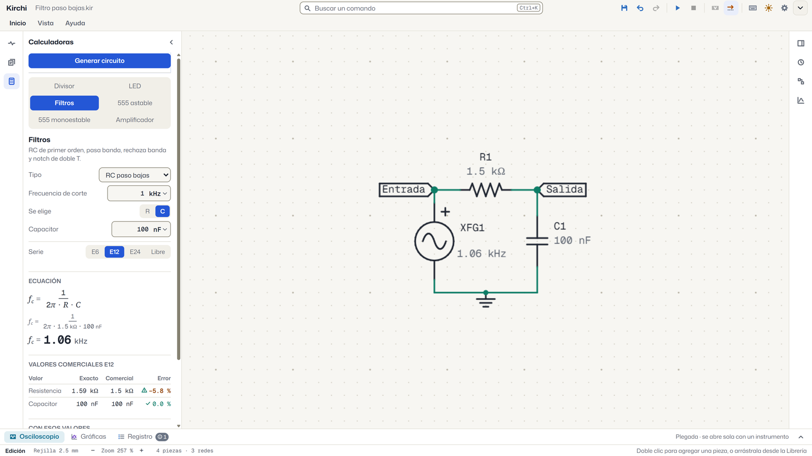 Calcula un filtro y genera su circuito con un clic.</td>
  </tr>
</table>

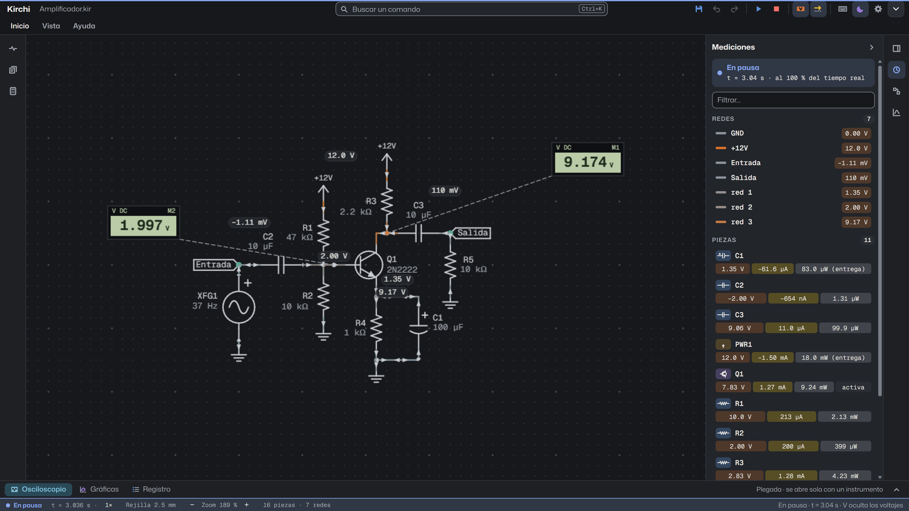 También en tema oscuro.

## Del circuito a la placa

El recorrido de un circuito en Kirchi, desde que se dibuja o se importa hasta que se entrega o se fabrica:

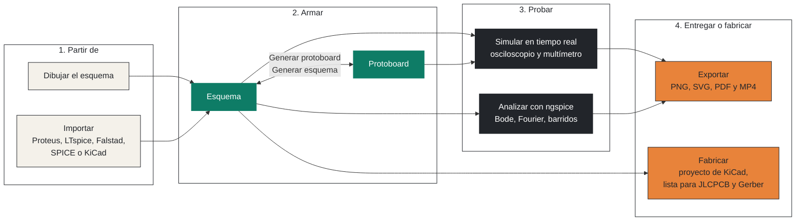

## Qué incluye

**Editor de esquema.** Rejilla de 2.5 mm con símbolos ANSI/IEEE, 113 piezas con modelo eléctrico en nueve categorías (pasivos, fuentes, semiconductores, integrados, digitales, interruptores, indicadores, electromecánicos e instrumentos), con sensores, motores a pasos, JFET, IGBT, optoacopladores, fuentes controladas y lógica MSI (decodificadores, multiplexores, sumador, comparador, contadores y registros de desplazamiento, y el convertidor ADC0804). Los chips de varias unidades se nombran U1A, U1B y llevan el número de cada pin y cables que se enrutan solos sin atravesar piezas. Valores con unidad y series comerciales (`4k7`, `100n`), buscador de comandos con `Ctrl+K`, notas, etiquetas y deshacer.

**Protoboard.** Además del esquema, una vista de protoboard con placas de 830, 400 y 170 puntos y piezas con su aspecto real, resistencias con bandas de color incluidas. Esquema y protoboard trabajan por separado con las mismas piezas: se puede colocar, copiar y borrar en cualquiera de las dos, y Generar protoboard y Generar esquema las sincronizan en las dos direcciones. Lo que falta o difiere se marca y se lista en Avisos. Se simula y se analiza la pestaña abierta, con las tiras teñidas por su voltaje, y con Medir en el clic derecho de una pieza de la placa se clavan las puntas de un multímetro o un osciloscopio. Se exporta a PNG, SVG o PDF.

**Simulación en tiempo real.** Motor analógico y digital propio, con las mismas ecuaciones que ngspice. Ocho velocidades, de ×10 a ×0.001, avanzar y retroceder en el tiempo, perillas en vivo (potenciómetro, termistores, fotorresistencia, sensores) e interruptores que se accionan mientras corre, y avisos cuando una pieza pasa sus límites.

**Instrumentos.** Osciloscopio de cuatro canales con disparo, cursores, medidas automáticas y modo X-Y. En pausa se cambian sus escalas sobre lo ya capturado. Multímetro, generador de funciones con amplitud pico a pico, pico o rms, fuente variable y medidores rápidos con pantalla de siete segmentos.

**Análisis con ngspice 47.** Punto de operación, barrido de CD, transitorio, CA y Bode, Fourier y barrido de parámetro. Gráficas con cursores, trazas una contra otra (X-Y) y rangos que puedes escribir.

**Para la entrega.** Exporta a PNG, SVG y PDF con fondo blanco o tema oscuro, solo la selección o un área, y anotaciones que no ensucian tu circuito. Graba la ventana en video MP4, con o sin micrófono.

**Importar.** Abre circuitos de Falstad, LTspice, netlists SPICE, KiCad y Proteus como documento nuevo, con un informe de lo convertido y una caja gris para lo que no tiene equivalencia.

**Fabricar una placa.** Archivo › Exportar para fabricar revisa la huella de cada pieza y escribe un proyecto de KiCad (esquema, placa vacía y biblioteca de símbolos), la lista de materiales para JLCPCB y la netlist. Una guía de dieciséis pasos dentro de Kirchi lleva del circuito, pasando por esa exportación y por KiCad, a los archivos Gerber. La placa se dibuja en KiCad.

**Para aprender.** Tutorial «Aprende Kirchi» de cinco capítulos, quince plantillas listas para simular y seis calculadoras (divisor, LED, filtros, 555 astable y monoestable, amplificador) que muestran la ecuación con tus valores y generan el circuito.

**Asistente (opcional).** Un asistente de IA como Claude puede armar, simular y medir circuitos en Kirchi por el protocolo MCP. Viene apagado y todo ocurre en tu equipo.

**Español e inglés.** La interfaz, las piezas, el tutorial y las plantillas están en los dos idiomas. El idioma se elige en Configuración o con `Ctrl+K`.

La guía completa está en [docs/guia-de-uso.md](docs/guia-de-uso.md) ([English](docs/guia-de-uso.en.md)).

## Conectar un asistente (opcional)

Kirchi funciona sin conexión y el asistente viene apagado. Para usarlo:

1. Abre Configuración › Asistente y activa el permiso.
2. Pulsa «Copiar configuración del asistente» y pega el texto en la configuración de tu cliente MCP (Claude Desktop, Claude Code u otro). El estado de la pestaña dice «Listo. Escríbele al asistente desde tu cliente.»
3. Pídele algo, por ejemplo «arma un divisor que dé 3.3 V desde 5 V y mide la salida».

El asistente puede construir, simular, leer mediciones y exportar la imagen del circuito abierto, usar plantillas y calculadoras, guardar análisis y trazar por pin, y trabajar con los archivos de Documentos\Kirchi\Asistente. Cada paso se deshace con Ctrl+Z. Con el instalador la configuración usa la ruta completa de Kirchi y con la Microsoft Store usa el alias `kirchi`.

## Descargar e instalar

La forma más sencilla en Windows es la [Microsoft Store](https://apps.microsoft.com/detail/9pks3qd294cn). Para cualquier sistema, los instaladores están en [Releases](../../releases/latest) y en la [página de descarga](https://misaelavila49.github.io/Kirchi/).

La Microsoft Store instala y actualiza Kirchi sola. Con los archivos de Releases, los instaladores no están firmados con un certificado de pago, así que cada sistema pide una confirmación la primera vez:

| Sistema | Archivo | La primera vez |
|---|---|---|
| Windows | `Kirchi-x.y.z-Windows-instalador.exe` | SmartScreen avisa de un editor desconocido: «Más información» y «Ejecutar de todos modos». |
| Windows portátil | `Kirchi-x.y.z-Windows-portable.zip` | Se descomprime y se abre `Kirchi.exe`, sin instalar nada. |
| macOS | `Kirchi-x.y.z-macOS.dmg` | Arrastra Kirchi a Aplicaciones. Si macOS no puede verificarla, abre Ajustes del Sistema › Privacidad y seguridad y pulsa «Abrir de todos modos». Si dice que está dañada, ejecuta `xattr -cr /Applications/Kirchi.app` en la Terminal. |
| Linux | `Kirchi-x.y.z-Linux.AppImage` o `Kirchi-x.y.z-Linux.deb` | La AppImage necesita permiso de ejecución (`chmod +x`). |

Los circuitos se guardan en archivos `.kir`, que se abren con doble clic.

## Cómo funciona

Kirchi es una aplicación de Electron con la interfaz en SolidJS y un lienzo WebGL2 propio. La simulación en tiempo real corre en un motor escrito en Rust, compilado a WebAssembly, dentro de un Web Worker que comparte memoria con la interfaz. Los análisis formales los resuelve ngspice como un proceso aparte.

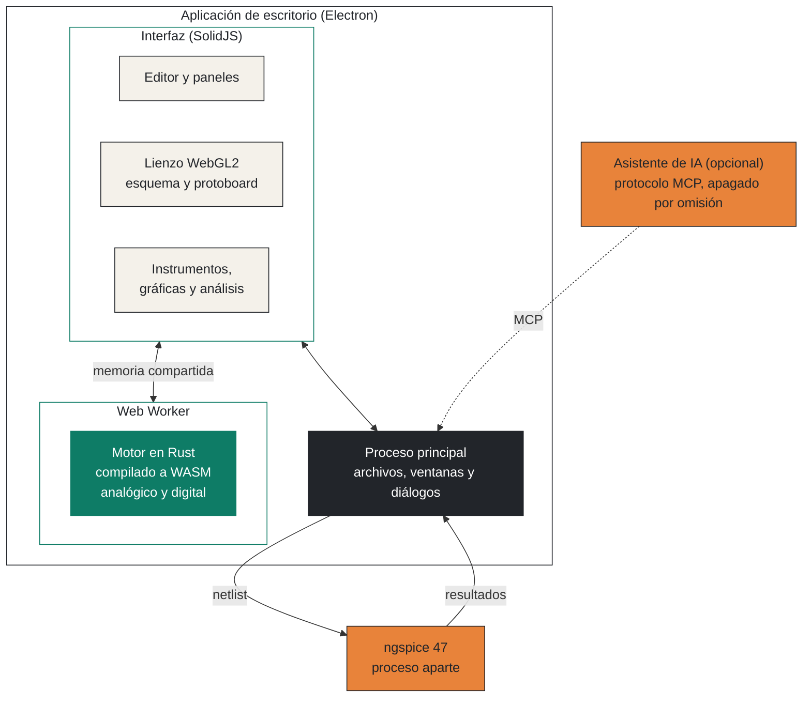

## Apoyar a Kirchi

Kirchi es gratuito. Si te sirve, puedes apoyar su desarrollo con una aportación voluntaria, en [GitHub Sponsors](https://github.com/sponsors/MisaelAvila49), [PayPal](https://paypal.me/MisaelAvila49) o [Mercado Pago](https://link.mercadopago.com.mx/kirchi). No desbloquea nada: todas las funciones son iguales para todas las personas.

## Licencia

Kirchi es gratuito y se usa con sus [términos de uso](LICENSE): puedes usarlo y compartir los instaladores oficiales sin cobrar, pero no venderlo ni distribuir copias modificadas. El código de Kirchi no es público desde la versión 3.1.1; las versiones hasta la 3.0.0 se publicaron con la licencia MIT y la 3.1.0 con Apache 2.0, y siguen bajo esas licencias. ngspice, las fuentes tipográficas y las demás dependencias conservan sus propias licencias, que se reúnen en [docs/licencias-terceros.md](docs/licencias-terceros.md) y se muestran en «Acerca de»; el código fuente que sus licencias piden se entrega con cada versión. Kirchi no envía datos: [aviso de privacidad](https://gist.github.com/MisaelAvila49/26b174fbe0fbfba7ef4c4176b3a25404).

Hecho por Misael Saúl Avila López · [misaelavila49@gmail.com](mailto:misaelavila49@gmail.com)
