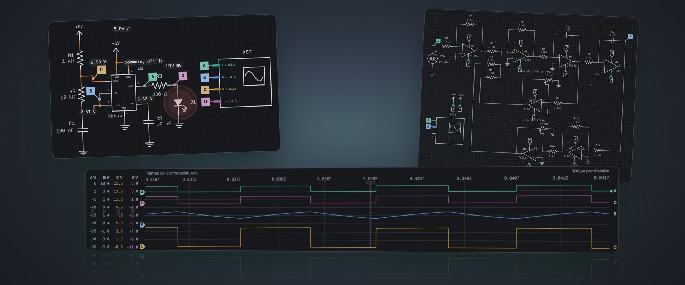
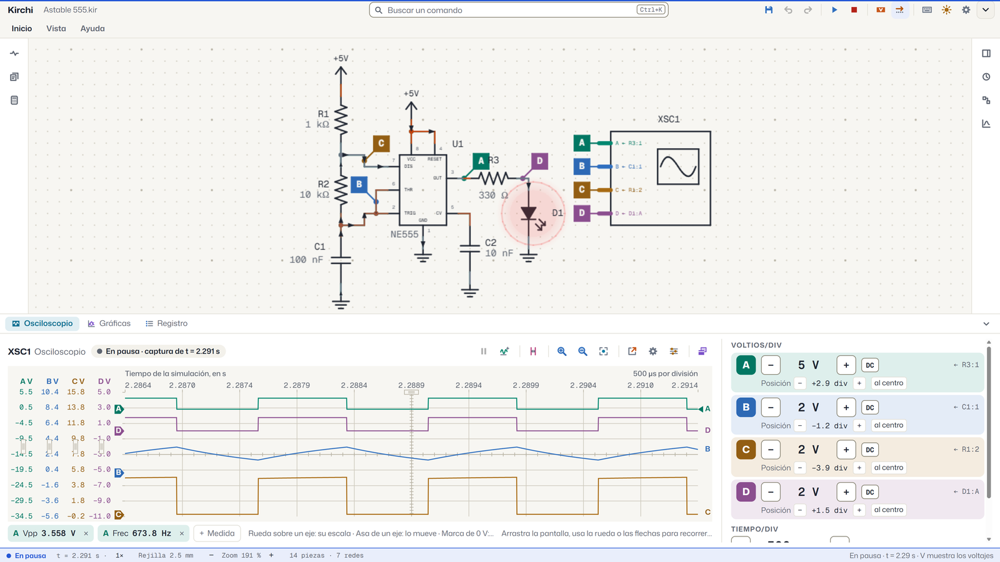
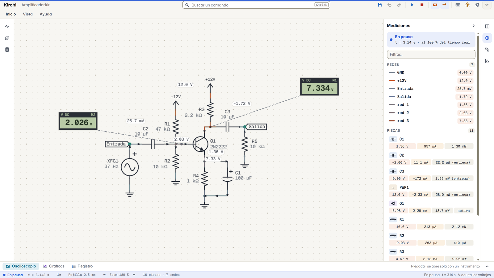
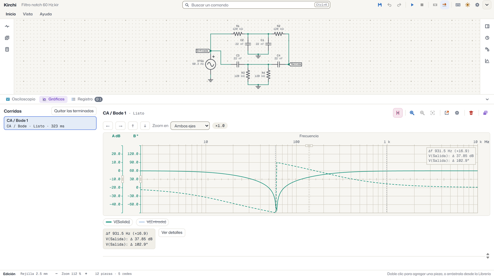
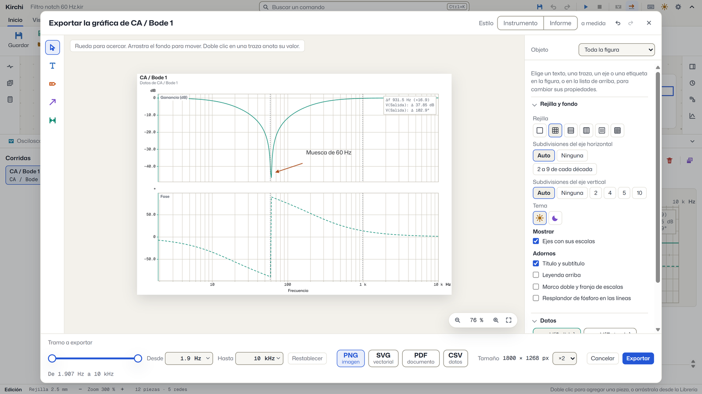
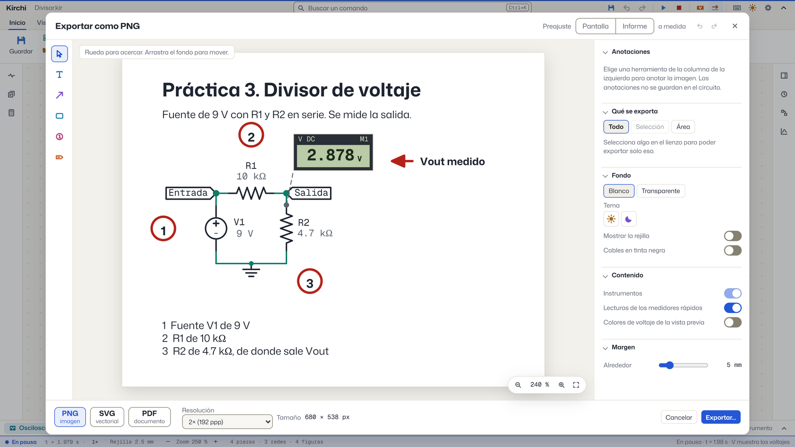
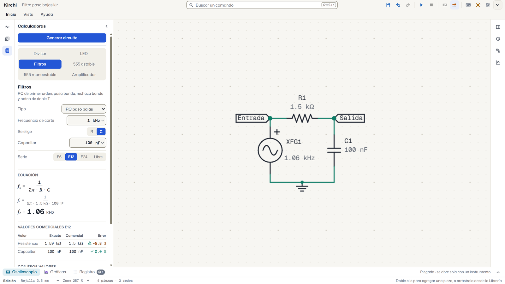
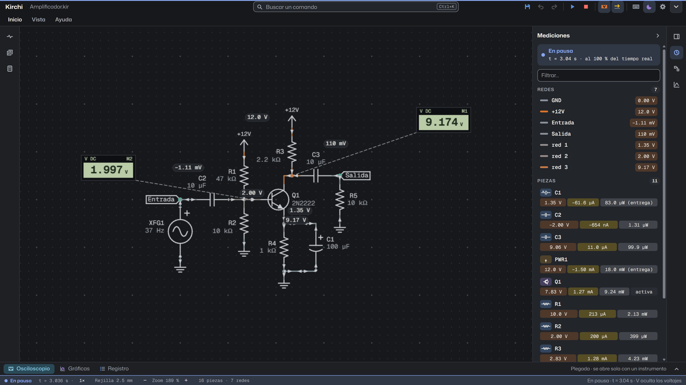
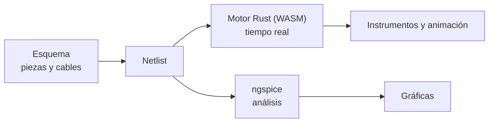

<div align="center">


# Kirchi

**El simulador de circuitos que te hubiera gustado tener en la carrera.**

Armas el circuito, pulsas F5 y lo ves funcionar. Gratis, sin internet, sin cuenta y en español.

[](https://apps.microsoft.com/detail/9pks3qd294cn)
[](../../releases/latest)
[](https://misaelavila49.github.io/Kirchi/)

[](LICENSE)
[](CHANGELOG.md)




</div>

## Por qué Kirchi

Kirchi es un simulador de circuitos de escritorio para estudiar electrónica: dibujas el esquema en una rejilla, simulas en tiempo real y mides como en el laboratorio, con un osciloscopio, un multímetro y análisis formales con ngspice.

| | |
|---|---|
| **Gratis y libre** | Licencia MIT, sin pruebas que caducan, sin anuncios y sin funciones de pago. |
| **Sin internet ni cuenta** | Todo pasa en tu computadora. No se envía ningún dato. |
| **Lo ves funcionar** | Los cables se pintan según su voltaje, la corriente se mueve por cada rama, los LED encienden y las piezas se queman cuando pasan su máximo. |
| **Mide como en el laboratorio** | Osciloscopio de cuatro canales con sondas y modo X-Y, multímetro, generador de funciones, fuente variable y medidores rápidos sobre cualquier cable. |
| **Análisis de verdad** | ngspice viene incluido: punto de operación, barrido de CD, transitorio, Bode, Fourier y barrido de parámetro. |
| **Listo para el reporte** | Exporta esquemas y gráficas a PNG, SVG o PDF con títulos, flechas, llamadas numeradas y lecturas. |
| **Fácil de aprender** | Interfaz en español, tutorial dentro de la aplicación, plantillas y calculadoras que generan el circuito. |

## Capturas

<table>
  <tr>
    <td width="50%"><br><sub>Cuatro señales de un 555 a la vez, con sondas sobre el circuito.</sub></td>
    <td width="50%"><br><sub>El voltaje de cada cable, la corriente en movimiento y medidores rápidos.</sub></td>
  </tr>
  <tr>
    <td><br><sub>Bode de un filtro notch de 60 Hz, con cursores.</sub></td>
    <td><br><sub>La gráfica anotada y lista para exportar.</sub></td>
  </tr>
  <tr>
    <td><br><sub>El esquema con título, flechas, números y lecturas.</sub></td>
    <td><br><sub>Calcula un filtro y genera su circuito con un clic.</sub></td>
  </tr>
</table>

<div align="center"><br><sub>También en tema oscuro.</sub></div>

## Qué incluye

**Editor de esquema.** Rejilla de 2.5 mm con símbolos ANSI/IEEE, 113 piezas con modelo eléctrico en nueve categorías (pasivos, fuentes, semiconductores, integrados, digitales, interruptores, indicadores, electromecánicos e instrumentos), con sensores, motores a pasos, JFET, IGBT, optoacopladores, fuentes controladas y lógica MSI (decodificadores, multiplexores, sumador, comparador, contadores y registros de desplazamiento, y el convertidor ADC0804). Los chips de varias unidades se nombran U1A, U1B y llevan el número de cada pin y cables que se enrutan solos sin atravesar piezas. Valores con unidad y series comerciales (`4k7`, `100n`), buscador de comandos con `Ctrl+K`, notas, etiquetas y deshacer.

**Simulación en tiempo real.** Motor analógico y digital propio, con las mismas ecuaciones que ngspice. Ocho velocidades, de ×10 a ×0.001, avanzar y retroceder en el tiempo, perillas en vivo (potenciómetro, termistores, fotorresistencia, sensores) e interruptores que se accionan mientras corre, y avisos cuando una pieza pasa sus límites.

**Instrumentos.** Osciloscopio de cuatro canales con disparo, cursores, medidas automáticas y modo X-Y. En pausa se cambian sus escalas sobre lo ya capturado. Multímetro, generador de funciones con amplitud pico a pico, pico o rms, fuente variable y medidores rápidos con pantalla de siete segmentos.

**Análisis con ngspice 47.** Punto de operación, barrido de CD, transitorio, CA y Bode, Fourier y barrido de parámetro. Gráficas con cursores, trazas una contra otra (X-Y) y rangos que puedes escribir.

**Para la entrega.** Exporta a PNG, SVG y PDF con fondo blanco o tema oscuro, solo la selección o un área, y anotaciones que no ensucian tu circuito. Graba la ventana en video MP4, con o sin micrófono.

**Importar.** Abre circuitos de Falstad, LTspice, netlists SPICE, KiCad y Proteus como documento nuevo, con un informe de lo convertido y una caja gris para lo que no tiene equivalencia.

**Para aprender.** Tutorial «Aprende Kirchi» de cinco capítulos, quince plantillas listas para simular y seis calculadoras (divisor, LED, filtros, 555 astable y monoestable, amplificador) que muestran la ecuación con tus valores y generan el circuito.

**Asistente (opcional).** Un asistente de IA como Claude puede armar, simular y medir circuitos en Kirchi por el protocolo MCP. Viene apagado y todo ocurre en tu equipo.

La guía completa está en [docs/guia-de-uso.md](docs/guia-de-uso.md).

## Conectar un asistente (opcional)

Kirchi funciona sin conexión y el asistente viene apagado. Para usarlo:

1. Abre Configuración › Asistente y activa el permiso.
2. Pulsa «Copiar configuración del asistente» y pega el texto en la configuración de tu cliente MCP (Claude Desktop, Claude Code u otro). El estado de la pestaña dice «Listo. Escríbele al asistente desde tu cliente.»
3. Pídele algo, por ejemplo «arma un divisor que dé 3.3 V desde 5 V y mide la salida».

El asistente puede construir, simular, leer mediciones y exportar la imagen del circuito abierto, usar plantillas y calculadoras, guardar análisis y trazar por pin, y trabajar con los archivos de Documentos\Kirchi\Asistente. Cada paso se deshace con Ctrl+Z. Con el instalador la configuración usa la ruta completa de Kirchi y con la Microsoft Store usa el alias `kirchi`.

## Instalación

**Windows:** la forma más sencilla es la [Microsoft Store](https://apps.microsoft.com/detail/9pks3qd294cn), que instala y actualiza Kirchi sola.

También puedes bajar el instalador de la página de [Releases](../../releases/latest). Los instaladores no están firmados con un certificado de pago, así que cada sistema pide una confirmación la primera vez:

| Sistema | Archivo | La primera vez |
|---|---|---|
| Windows | `Kirchi-x.y.z-Windows-instalador.exe` | SmartScreen avisa de un editor desconocido: «Más información» y «Ejecutar de todos modos». |
| Windows portátil | `Kirchi-x.y.z-Windows-portable.zip` | Se descomprime y se abre `Kirchi.exe`, sin instalar nada. |
| macOS | `Kirchi-x.y.z-macOS.dmg` | Arrastra Kirchi a Aplicaciones. Si macOS no puede verificarla, abre Ajustes del Sistema › Privacidad y seguridad y pulsa «Abrir de todos modos». Si dice que está dañada, ejecuta `xattr -cr /Applications/Kirchi.app` en la Terminal. |
| Linux | `Kirchi-x.y.z-Linux.AppImage` o `Kirchi-x.y.z-Linux.deb` | La AppImage necesita permiso de ejecución (`chmod +x`). |

Los circuitos se guardan en archivos `.kir`, que se abren con doble clic.

## Cómo funciona

Kirchi es una aplicación de Electron con la interfaz en SolidJS y un lienzo WebGL2 propio. La simulación en tiempo real corre en un motor escrito en Rust, compilado a WebAssembly, dentro de un Web Worker que comparte memoria con la interfaz. Los análisis formales los resuelve ngspice como un proceso aparte.



Las piezas son datos, no código: cada una es una carpeta con un `pieza.json` y un `simbolo.svg`. Para agregar una no hace falta programar. La guía está en [componentes/LEEME.md](componentes/LEEME.md).

## Compilar desde el código

Necesitas Node 24 o superior y Rust estable con el objetivo WebAssembly. En Windows también hacen falta las Build Tools de MSVC, con la carga «Desarrollo para el escritorio con C++».

```bash
rustup target add wasm32-unknown-unknown
npm ci
npm run build      # motor WASM y aplicación
npm start          # abre la aplicación construida
npm run dev        # desarrollo con recarga
```

```bash
npm test               # pruebas de la interfaz
npm run typecheck      # tipos
npm run test:engine    # pruebas del motor en Rust
npm run e2e            # pruebas de extremo a extremo con Playwright
npm run dist           # instalador de Windows
```

| Carpeta | Contenido |
|---|---|
| `src/main` | Proceso principal: archivos, ventanas, ngspice. |
| `src/preload` | Puente seguro entre el proceso principal y la interfaz. |
| `src/renderer` | Interfaz, editor, lienzo, instrumentos, análisis y calculadoras. |
| `src/compartido` | Código común a los procesos. |
| `engine` | Motor de simulación en Rust, analógico y digital. |
| `componentes` | Piezas, plantillas incluidas y familias lógicas. |
| `e2e` | Pruebas de extremo a extremo sobre el ejecutable. |

## Licencia

Kirchi es software libre con licencia [MIT](LICENSE). ngspice, las fuentes tipográficas y las demás dependencias conservan sus propias licencias, que se reúnen en [docs/licencias-terceros.md](docs/licencias-terceros.md) y se muestran en «Acerca de».

Hecho por Misael Saúl Avila López · [misaelavila49@gmail.com](mailto:misaelavila49@gmail.com)
